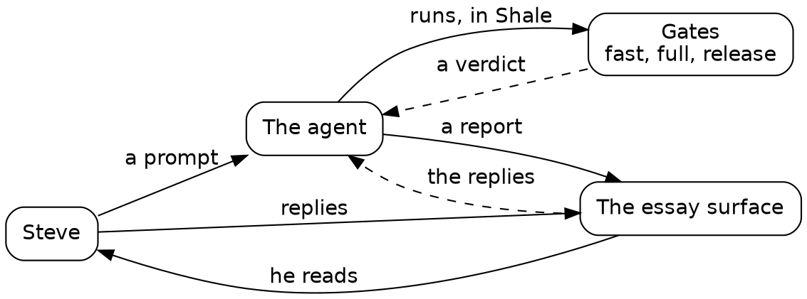
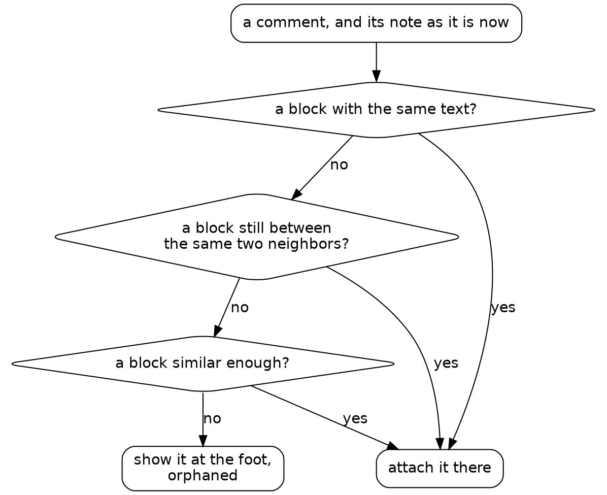
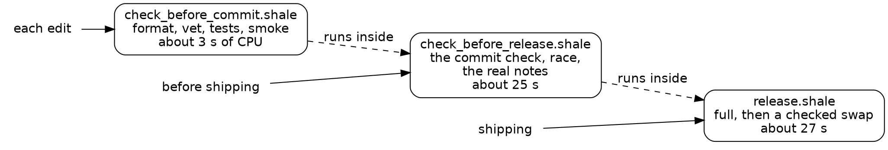
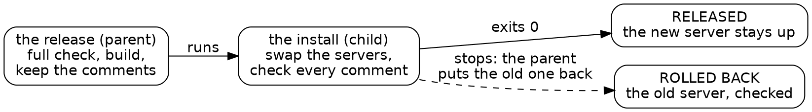

# Automating agentic development with Shale

A book for experienced developers who are new to working with agents. We follow one side project, a new essay surface built over a series of sessions, one a chapter, and read the Shale our agent wrote along the way.

This is draft 2, rough in places: prose, code and diagrams.

## Introduction

Shale is a programming language written by agents, for agents. It looks like Lua, and it mostly works like any mainstream language: variables, functions, loops, lists and maps, strings and files. Its unique features are built for its niche, which is scripts an agent writes and a human reads.

That niche is the premise of this book. You will read a lot of Shale and write very little. Your agent writes it, every time it searches your code, runs your tests, renames across a tree or ships a release. You read it as it scrolls by, judge it, and steer the agent that wrote it. This book teaches you to do that well.

### Who this book is for

This book is for experienced developers: people who have written plenty of code, but not much of it with an agent. You know a build from a test and a test from a gate. You may have tried an agent on a small task and wondered what it would take to trust one with a real project. You're curious about programming languages, and open to letting an agent do real work.

### Agents in late 2026

This book was written with late-2026 agents, and agents change fast. If your picture of agents is a year old, they're already better than you think. And some of the workflow here may be obsolete by 2027. So the book teaches principles that last. The first is that an agent can't read your mind, so getting your requirements across is always part of the bottleneck. That's why this book's project is an essay surface, where you reply to the exact paragraph you mean.

You won't find skills files here, the instruction files some setups use to teach an agent a task. A modern agent learned how to do things in training. What it needs from you is a mission and a standard, so this project has mission documents, style guides and Shale gates instead.

### The project

The book follows one side project. We build a new essay surface: a small web app where an agent's notes, written in markdown, become pages, and Steve, who runs this project, reads them in a browser and replies to any paragraph. A Go server sits behind a plain-JavaScript front end. Steve soon used it to reply to the drafts of this book. The first two prompts have the roles turned around: they say "I write notes" and "I read those comments". In practice the agent writes the notes, Steve replies, and the agent reads his replies to steer its next draft.

We tell it in sessions, a chapter each. A session is one stretch of work that starts with one prompt. The sessions aren't days: the real build took an afternoon of agent time, and the merge in Session 6 and the feature in Session 7 came the next morning. An essay surface isn't an agent harness, the program an agent runs inside, but in both a human reads what was written, replies, and steers.

### We, and the prompts

The book says "we" for Steve and his agents, AI models working in a terminal on his behalf. Steve talks to one of them, the orchestrator: Claude acting as his proxy, which plans with him, writes the prompts and checks the work. The orchestrator hands most prompts to a cold agent, a fresh agent with no memory of our conversation, given one task and a short brief. Each session opens with its prompt, quoted whole. A prompt is what we ask an agent to do, in plain words, and a session's first prompt sets its mission. Later prompts mostly enforce standards, and a few improve the workflow itself. Then the book follows the agent's own Shale, quoted from the journal it kept. The agents were real, the prompts were real, and so were the mistakes. When something went wrong, the book says so, along with what caught it and what habit it taught.

The agents run in Claude Code, a harness. Its shell tool runs only Shale on this project, and a hook, a check the harness runs before every command, stops anything else. Steve replies on the essay surface itself, and when he says his replies are in, the orchestrator reads the note's comments file and passes on what each agent needs. That beats quoting a paragraph back in chat: a reply sits on its paragraph, and stays there as the note changes.

### Gates

The thread through every session is gates. A gate is a script that holds work to a standard. It runs the checks, prints a verdict on its last line, and fails when the work falls short. Gates are how we write quality software with agents, because they turn a rule into something that runs on every change.

Gates arrive when the work asks for them, from a check before a commit in Session 1 to a release with a rollback in Session 5.

Gates need a language to write them in. Next, a short tour of Shale.

## Meet Shale

The quickest way to meet a language is to read some, so here's a real gate: `scripts/check_before_commit.shale`. It comes from later in the project, where it's the check the agent runs on every edit, in a few seconds. First, the helper that runs each stage:

{{function repos:essay-surface/scripts/check_before_commit.shale stage}}

Then the stages, in order: the formatter, `go vet`, a syntax check of the front end, the Go tests, and a smoke test through the real server. One more line after them prints the verdict, `fast: PASS`.

{{lines repos:essay-surface/scripts/check_before_commit.shale from "local fmt = stage(" to "checks through the real server"}}

If you've read Lua, this looks familiar, and that's on purpose. `local` declares a variable, `function` and `end` frame a function, braces build a list or a map, and `..` joins strings. The rest is the mainstream you know.

### What Shale adds

A few features are Shale's own, and most of them show up in check_before_commit.shale:
- **Every run has budgets:** steps, reads, bytes read and printed, memory, and the programs it starts. A runaway script stops and says which budget it hit. A program can get a CPU budget too, and check_before_commit.shale gives each stage one, `cpu_budget_ms`, so a stage that turns slow fails.
- **A script works inside its own folder** and the folders it mounts. A mount is a named folder beyond its own, written `name:path`, so you can see everything a script can reach. Every path in check_before_commit.shale, such as `.` or `comments.js`, is inside its repository.
- **A risky program runs when the script gives its reason.** A shell, an interpreter, a text tool or a program git doesn't track requires a reason, and the reason is logged. `node` is an interpreter, so the js stage says why it runs.
- **A stop is one line** that says where and why. When a stage fails, check_before_commit.shale ends on one line that names it, such as `vet: go exited 1`.
- **A prelude does the daily work.** The prelude is Shale's built-in library: git, jobs, HTTP, JSON, and refactors that read code the way its compiler does. A job is a program that outlives the call that started it, such as a server. `run` comes from the prelude too.

### Who builds what

Shale builds nothing itself. `go build` makes the server, and `go test` compiles the tests. Shale runs those programs, keeps what they said, and checks what came out: check_before_commit.shale reads go test's output and counts the tests that passed.

### A language that changes

Shale is meant to have dialects. A dialect costs a team of humans a great deal, since everyone must learn it, and an agent very little, since it reads the docs every session. Session 6 shows a new word arriving, and what that means for your own copy.

The same goes for recipes, scripts saved to a file because their question came back. Shale has a cookbook of them, and your agent builds its own library on top of it, or instead of it.

### What it costs

Shale doesn't save tokens, and it may add to them. It also slows you down at first, while your agent builds up its recipes. What it buys, above all, is a higher-level language than bash, one where you can build real primitives. A bash script strings commands together and greps their text. In Shale, `run` returns a record with the exit code and the output, functions take and return lists and maps, and a helper like check_before_commit.shale's `stage` becomes a word the next script uses. Each primitive your agent builds makes the next script shorter and easier to read, and the budgets and folders keep every one of them inside lines you can see.

### Four words for what's next

Four words come up from the first session on. `run` needs a timeout and a keep. A keep is how much of a program's output `run` holds on to. `whole` and `tail` are the two keeps:
- **`want`:** the reason a script gives for running a risky program, written `want = "tag: why"`. Shale logs it.
- **`whole`:** a keep in bytes. `run` holds all of the output up to that size, and each stage in check_before_commit.shale holds up to 400,000 bytes.
- **`tail`:** a keep in lines. `run` holds the program's last lines, where its verdict usually sits.
- **`must`:** `must(r)` returns a run that exited 0, and fails the script on any other, printing the output and naming the program. check_before_commit.shale's `stage` does the same job, with more to say when a test fails.

That's enough Shale to start. Next, one turn of the loop, from a reply to a change.

## One loop

Before the first session, here's one complete turn of the loop the whole book is made of: an agent reports, Steve replies, the agent changes the code, and we read what it ran. It comes from Session 4, and it took a few minutes.

*The loop. Steve steers with prompts and replies, and the agent answers with code that has passed its gates, plus a report.*

### The report

Here we preview the end of Session 3. The agent's report there listed a few decisions Steve might reverse. One said the server needs the comments folder's parent to exist when it starts. Steve read the report on the essay surface and replied to that paragraph. The server appended his reply to the note's comments file, one JSON line per reply:

{{fence repos:essay-surface/journal/reply.md "add a defensive check"}}

That's the whole of the steering. Attach each reply to the paragraph it answers: the paragraph carries the context, so four words are a complete instruction. The `quote` is that paragraph, and `prev` and `next` fingerprint its neighbors, as Session 2 explains. The orchestrator passed this reply and one more to the agent already at work on Session 4, mid-run.

### The change

The agent added the check in Go, where the server starts:

{{lines repos:essay-surface/store.go from "// The parent is checked, never made" to "is not a folder; make it"}}

Its comment says why: a mistyped folder name would otherwise grow a folder of comments where nobody looks. It added a test for a missing parent, a parent that's a file, and one that exists. Then it planted a fault once, saw the test go red, and took the fault out.

### What we read

Last, the agent ran the real server once with a folder that doesn't exist, to see the message where a person would meet it. This is what scrolled by:

{{fence repos:essay-surface/journal/session-4.md "what the real server says when the comments folder"}}

{{fence repos:essay-surface/journal/session-4.md "made: false"}}

Read every script that goes by at scroll speed, with three questions. A few seconds a script is what lets you judge an agent's work as fast as it runs:
- **What does it read?** One folder of notes, and whether `.run/no-such-folder` exists afterwards.
- **What does it run?** `./essay-surface`, the server it just built. Because that binary isn't tracked by git, `run` requires a reason, and the script gives one: `want = "build: the server we just built"`.
- **How did it end?** Exit 1, with the message, and `made: false`: the server stopped and created nothing.

That run shows the check working for real, and the test and the planted fault cover the rest.

### Why Shale, and not bash

The same check in bash is one line: run the server, echo `$?`, list the folder. It works on a good day. On a bad day, when the check is missing, the server starts listening and never exits, and the agent's shell hangs on it. The Shale version stops waiting: `run` requires a timeout, here 10 seconds, and a keep, here the last 5 lines. A program the repository doesn't track runs only with a reason, and the reason is logged. Every line of the script says what it touches, so the reader can judge it at a glance. That's the bargain the whole book rests on: slightly longer scripts that a human can read in seconds.

## Session 1: the bugs the tests missed

Session 1 starts with an empty repository and this prompt:

{{quote repos:essay-surface/journal/prompts/session-1.md}}

The orchestrator wrote this prompt from a plan Steve gave it and handed it to a cold agent. The agent worked for about twelve minutes, and Steve didn't step in. "Five hundred notes" says where to work: Steve has about that many on the old surface, the Python server he used before this one, and the agent works against the real ones.

The agent wrote the server and its markdown renderer in Go, with no dependencies, and a dozen real notes to serve as samples. What this chapter follows is how it checked that work, because that's where Shale comes in.

### A gate before a commit

Before its first commit, the agent saved a recipe, `scripts/check.shale`. Every commit after it passes through this script, so it's the first one worth reading closely. Here it is as Session 1 left it:

{{show repos:essay-surface d793c5a:scripts/check.shale}}

Read it the way you'd read any short script. Three programs run, one after another: `gofmt -l` lists any file that isn't formatted, `go vet` looks for suspicious code, and `go test` runs the tests. Each `run` starts a program and keeps what it said. `must` fails the script unless the program exited 0, and `fail` stops it with a reason. So the script either prints three verdicts or stops on the first one that's wrong.

When it passed, it said so in three lines:

{{fence repos:essay-surface/journal/session-1.md "vet: clean, 454 ms"}}

### A green is a claim

A passing gate says the tests ran. It doesn't say how many did, or whether the ones you meant to add were among them. So the agent counted:

{{fence repos:essay-surface/journal/session-1.md "how many tests and subtests actually ran?"}}

{{fence repos:essay-surface/journal/session-1.md "PASS lines: 69"}}

Sixty-nine passed, seven of them top-level tests, and none failed. That's a number you can check against the test file, which "ok" never is. Count what ran, every time a gate turns green for the first time. Green ✅

### The audit

The tests checked the cases the agent thought of. To find the rest, it saved a second recipe, `scripts/audit.shale`. It starts the server on all of Steve's real notes, fetches every page, stops the server, and then counts markdown left over outside code: a stray `**`, a `](`, a table's `|---`, or a backtick. Any of those in a rendered page is a construct the renderer missed.

It found two real bugs that the 62 hand-written test cases had missed:

{{fence repos:essay-surface/journal/session-1.md "<title>Review: gopher-roc"}}

Titles kept their markdown, and a lone triple backtick in a table cell swallowed the rest of its row. Each fix got a test, the table one copied from the note that found it.

Run your code over real data before you trust your own tests. Your tests hold only the cases you thought of, and five hundred real notes hold the rest. The audit cost one script and under a second of running, and it found what the tests couldn't.

Not every script ran the first time. The agent hit a few stops along the way, each one line, and fixed each in its next call. Reading a stop is a craft of its own, and it can wait until you know what a run that works looks like.

The agent also saved a benchmark. A note takes about a tenth of a millisecond to serve, which is all a first version needs to know.

### The gates now

`check.shale` runs before every commit: gofmt, vet and every test. The audit runs by hand for now, and Session 3 makes it a stage of a gate.

## Session 2: replies that stay put

Session 2 asks for the feature the surface exists for:

{{quote repos:essay-surface/journal/prompts/session-2.md}}

A cold agent took this prompt and worked for about half an hour. Steve stepped in once, after looking at the result in his browser, and the orchestrator made that fix.

The first bullet is the hard one. The old surface stores a comment's place as a position, `"para_index": 4`, so a paragraph added above sends every comment below it one paragraph off.

### A reply finds its paragraph

A reply belongs to a paragraph, and it has to find that paragraph again after the note changes. The obvious design remembers the paragraph's text and, on each render, picks the most similar block. The agent tried that idea on Steve's real notes before building it, and it failed: a short block with one typo can look less like itself than another block looks like its neighbor, so a deleted paragraph would hand its replies to a look-alike.

So the design added structure. A comment also remembers the fingerprints of the blocks before and after it. On each render it goes, in order, to the block with the same text, the block still between the same two neighbors, the most similar block, or the orphans at the foot of the page. A deleted block leaves its neighbors touching, so the second rule tells a deletion from an edit.

*How a reply finds its paragraph. Each rule is tried in turn, and a comment is never lost.*

The first simulation of the real resolver panicked, on a block the agent's own test code removed twice. The second ran past its timeout and was killed. A killed program has no exit code, only an `ended` that says why, so the script stopped on the line that read `code`:

{{fence repos:essay-surface/journal/session-2.md "110.0 s in all"}}

The agent kept the timeout and found the waste: every simulated case recomputed the whole note. Its first cache went onto each case's copy of the note and was thrown away with it, so the third run timed out too. With each block's features cached once per note, the simulation ran over all of Steve's paragraphs. It deletes each real paragraph in turn, and 345 of those 22,928 deletions lent their comments to a look-alike; every edit in place kept its comments. The agent compared two measures of similarity and chose the one that misplaced fewer. When a guess can be wrong, prefer an honest failure to a confident wrong answer: an orphan at the foot of the page tells Steve to look, and a reply on the wrong paragraph misleads him.

### Seeding faults

Sixteen hand-written anchoring tests passed on their first run. To see whether they could fail, the agent broke the code twice, on purpose, and put it back each time. That's fault seeding, also called mutation testing, and we call each seeded fault a plant:

{{fence repos:essay-surface/journal/session-2.md "plant 1: no in-place rule"}}

`edit(path, old, new)` replaces text that must occur exactly once, so each break and each repair lands exactly where it says. Each `run` goes without `must`, since a red is the point. Each fault turned several tests red:

{{fence repos:essay-surface/journal/session-2.md "--- FAIL: TestAnchorTypoFixed"}}

This script is for one use: a fault left in place would prove nothing more. The agent did the same for the front end: `check.shale` now runs `node --check comments.js`, since `go test` never parses it, and one seeded syntax error turned that stage red.

### A script worth keeping

Some of the agent's scripts get a read at review speed, the slower read a script gets when the agent proposes to keep it: does it earn its place? `scripts/comments_smoke.shale` runs the whole comment flow through the real server. It posts a comment, fixes a typo and adds a paragraph above it on disk while the server runs, then deletes the paragraph. Its checks go through one small function:

{{function repos:essay-surface/scripts/comments_smoke.shale want}}

The end of the script shows how it holds a server:

{{lines repos:essay-surface/scripts/comments_smoke.shale from "local job = essay_start(" to "for l in result.value do print(l) end"}}

`attempt` runs `flow` and gives back its result or its stop, so the server is stopped before any verdict. That is the review question for every script that starts a server, and `bench.shale` failed it once in this session. Its run on all the real notes stopped on its budget for what a run keeps at each `yield`:

{{fence repos:essay-surface/journal/session-2.md "bench.shale:140:5"}}

A budget stop is the one stop `attempt` can't catch, so the server stayed up until the agent stopped it by its job record. The bench's budget line now leaves room.

A run of the smoke test prints each check it passed, from the first post to the orphan:

{{fence repos:essay-surface/journal/session-2.md "ok: and the file still has it"}}

Green again ✅

### Every check passed

The report's last item was an eye test, a look at a page in a browser, that the agent couldn't run, since its machine has no browser. Steve opened a note in his own, and found no way to reply. The buttons sat at opacity 0 and appeared only on hover. His words: "Hover is an anti-feature."

The fix set the buttons at opacity 0.6. Their first label was "note", which already meant the essays, so a second commit made it "reply". Steve has written his real replies on the new surface ever since. In Session 4, hidden reply buttons become a check that runs without a browser.

### The gates now

`check.shale` parses the front end and runs the anchoring simulation on the sample notes, its numbers held at what was measured. The browser caught what every check missed. Turn each miss into a check, so the same miss can't get past you twice.

## Session 3: a check for each moment

Session 3 turns a list of scripts into checks:

{{quote repos:essay-surface/journal/prompts/session-3.md}}

A cold agent worked for about half an hour on this one, and Steve didn't step in.

By now the essay surface had four scripts, and the last session's report listed what to run and when. A list is something to remember. This session made it two commands.

### An index that listens

The new server hears changes from the kernel, through Linux's inotify, instead of checking every note's file on every request, so the index now costs about as much as a note. The index's dates changed too: a note's date comes from its first lines, or else its last commit, never from the file's time. So a fresh clone, which resets every file's time, gives the same index, and that comparison became a stage of the full check.

### A check for each edit

`check_before_commit.shale` is the check the agent runs on every edit, the one from Meet Shale: five stages, each a line that calls the `stage` helper. Its last two stages count what ran: "44 tests passed, 63 subtests" can be checked, and "ok" can't.

What's new here is the budgets. A stage whose run spends more CPU than its `cpu_budget_ms` stops, naming the stage. The budgets are CPU time, never wall time: on this two-CPU machine, wall times ran 1.7 times as long at a load of 2 from other work, and the CPU a program spends moves much less. So a busy machine can't turn the verdict red, and a stage gone slow can. A real run takes 2.4 s:

{{fence repos:essay-surface/journal/session-3.md "5 programs, 2.4 s in all"}}

### A check before shipping

`check_before_release.shale` runs `check_before_commit.shale` first, then five stages on all of Steve's real notes: the Go tests under the race detector, the anchoring simulation from Session 2 (which replays edits to see where comments land), the audit of every rendered note from Session 1, the dates comparison, and the bench. Every stage runs, even after one fails, unless a stage breaks its CPU budget, so the last line names every stage that failed:

{{lines repos:essay-surface/scripts/check_before_release.shale from "local failed = {}" to "SAFE TO SHIP"}}

The bench needed more care, since its job is time. The server now logs, as it stops, the CPU its requests took, so the bench holds each kind of request to a CPU budget, about twice what real notes took:

{{lines repos:essay-surface/scripts/bench.shale from "const CPU_BUDGET_US" to "const CPU_BUDGET_US"}}

One budget for the whole mix hid a slow index under the many comment posts, so each kind got a server of its own. The old scan, put back once, broke the index's budget more than five times over.

Slowness is a finding too. The anchoring simulation took 13 s, so the agent profiled it: the time was the work itself, 187,000 simulated edits, and it stays.

### The test that hid others

The store's new tests all passed on their first run. So the agent seeded a fault, a deaf watch: one line that made the server read nothing from the kernel's queue. Three tests went red, but every test that edits a note should have. The agent ran it again with the panic lines shown:

{{fence repos:essay-surface/journal/session-3.md "slice bounds out of range [:-1] [recovered, repanicked]" from "slice bounds" to "0.042s"}}

`TestCommentsFollowEdits`, written in Session 2, sliced `page[:i]` with `i` at -1 when the page had no orphans section, where a deleted paragraph's comments go. The panic ended the test binary, and every test after it went unreported. Its runs in Session 2 gave no sign, because nothing failed then. With the panic made a plain failure, the same deaf watch turned twelve tests red. After seeding a fault, count how many tests went red against how many should have, because a test that panics hides every test after it. The next session makes that trick a habit.

Then the full check went red on purpose: the renderer wrote `<b>` for `<strong>`, which looks the same on the page. The verdict was right, `NOT SAFE: fast, race failed`, but the red first stage, then named `fast`, showed the last lines of `go test -v`, and those were passes. Now fast keeps only the failed tests and their lines, and its stop names them:

{{fence repos:essay-surface/journal/session-3.md "1 failed: TestRender (86718 steps)" from "markdown_test.go:100" to "stopped at"}}

The audit, which reads every rendered note for markdown left over, passed that fault, since it never checks which tags appear; the renderer's tests caught it. Each check has its own job.

### The gates now

`check_before_commit.shale` runs on every edit, in about three seconds, and stops at the first failing stage, naming the failed tests. `check_before_release.shale` runs before anything ships, holds every stage to a CPU budget, and ends on one line: `SAFE TO SHIP`, or `NOT SAFE` and the stages that failed.

## Session 4: making the checks fail

Session 4 asks whether those checks can fail:

{{quote repos:essay-surface/journal/prompts/session-4.md}}

A cold agent worked for about seventeen minutes. Steve stepped in once, with two replies that the orchestrator passed on mid-run.

Can every stage really go red? Session 3 saw `NOT SAFE` once, for one fault. Asking whether a gate can fail is reading it at trust speed, a third speed after scroll and review: what proves the gate is watching?

### One fault per stage

This session seeded one fault in each stage, ran the stage, and took the fault out. A plant done once and removed catches tests that test nothing, as the deaf watch did in Session 3. A fixture is the permanent kind: a small input a check must reject or accept, run on every check. Steve is wary of fixtures, because they can slow gates, often through needless rebuilds.

`check_before_release.shale` has six stages, and its first, `commit`, has five of its own, so that made eleven plants. Every launch had the same shape: the fault in (`OLD` becomes `NEW`), the stage run exactly as `check_before_release.shale` runs it, the fault out, then proof that the tree is back and `check_before_commit.shale` passes:

{{fence repos:essay-surface/journal/session-4.md "plant 1, fast's gofmt stage" from "OLD, NEW)" to "after: exit"}}

Each plant costs a rebuild and one run of its stage, from a few seconds to twenty, once. None was committed.

Every stage went red for its fault, and the faults that got past every other stage show why each stage exists. `fast` passed with a map read without its lock, which only the race detector caught. Only the smoke test runs the real server binary, so its fault was invisible to the Go tests.

### A stop with the fault still in

Plant 6's first launch named a stage with no CPU budget, and Shale stops on that. It stopped the script between the fault going in and coming out, leaving the fault in `store.go`. The agent removed it first:

{{fence repos:essay-surface/journal/session-4.md "the last launch stopped after planting"}}

Plants 1 to 5 had been lucky: a stop in any of them would have left its fault behind too. A script that edits files to test something must put them back on any stop, or one stop leaves a bug in the tree. After that, every plant ran under `shale --undo-on-stop`, which puts back every file a stopped run changed. The next try stopped on a mistake in the agent's own `print`, and Shale's last line shows the undo:

{{fence repos:essay-surface/journal/session-4.md "undone: 1 path(s) the run changed put back"}}

### Green with the fault in

The fourth plant wrote a commenter's name to the page without escaping it. The tests checked the comment's text, and nothing checked the name, so `fast` passed:

{{fence repos:essay-surface/journal/session-4.md "ok  test, 2474 ms" from "ok  test" to "fast: PASS"}}

That is a real security hole: a commenter named `<script>...` would run code on every reader's page, and every stage of the full check passed with it. Test every field that reaches the page, not just the one you thought about, since the field you skipped is the hole. The agent wrote the missing test, which puts markup in every field:

{{fence repos:essay-surface/journal/session-4.md "func TestEveryCommentFieldEscaped"}}

It passed before the plant, failed with it, and passed after: green again ✅.

### Fixtures, and what they cost

Three kinds of fixture stayed, each one data the check reads. The audit reads a known-bad page and a known-good one before any real note, in under 5 ms, and a plant that blinded the audit stopped it there, before any server started. The hidden panic from Session 3 became data for the part of `check_before_commit.shale` that reads `go test` output:

{{lines repos:essay-surface/scripts/check_before_commit.shale from "A known-bad go test -v output" to "misreads testdata"}}

It costs 3 ms, and a plant that stopped the reader from recognizing a panic tripped it at once. The third kind is the reply-button sheets, below.

The rest of the plants proved their stages once and left. A known-bad Go file would turn `gofmt` and `vet` red forever unless the checks skipped it, and a skip that broad would hide real faults too. A racy program needs a `-race` build of its own, exactly the cost Steve named. A slow fixture for the bench needs a server.

### Reply buttons, without a browser

In Session 2 every check passed, and Steve opened a page with no visible way to reply: the buttons sat at `opacity:0` until hovered. `buttons_test.go` works out the CSS cascade itself, on the stylesheet the page is served with. It checks each place `comments.js` puts a button, at every width a media query names, light and dark. A button counts as hidden under `display:none`, `visibility:hidden`, or opacities that multiply out to under 0.5. It never runs the script, and it misses clipping and contrast.

Its fixtures are seven small sheets, five known-bad and two known-good, at 0.02 s inside `go test`. One is the real sheet from Session 2, taken from git:

{{fence repos:essay-surface/journal/session-4.md "the known-bad and known-good sheets for the reply-button check" from "testdata/buttons/hidden-at-rest.css" to "faint-article.css"}}

Putting its `opacity:0` back turned the test red at widths of 51 and 80rem. The checker got a plant of its own, opacities no longer multiplied, and `faint-article.css` caught it:

{{fence repos:essay-surface/journal/session-4.md "faint-article.css: want" from "--- FAIL" to "faint-article.css: want"}}

### Steve's two replies

The two replies answered the report from Session 3. The first was the defensive check from One loop. The server already failed when the comments folder's parent was missing, but by accident; now it checks first, names the path, and makes nothing. The second put phones out of scope. The README says so, and the narrow-window CSS stays: out of scope means unchecked, not removed.

### The gates now

Every stage of `check_before_release.shale` has been seen red once, and its kept fixtures run on every check in milliseconds. A page that hides its reply buttons fails `check_before_commit.shale` now, and so does a commenter's name that reaches the page unescaped.

## Session 5: shipping should be boring

Session 5 turns a chore into a script:

{{quote repos:essay-surface/journal/prompts/session-5.md}}

A cold agent built the release script and proved it on a dev port, away from the live server, in about sixteen minutes. Steve didn't step in, and the orchestrator ran the real release.

Boring is the goal. Steve's real replies now lived on the surface, and every release was still a chore done by hand. A script runs the same steps in the same order each time, and that sameness is what we mean by boring.

### A release, in order

The agent's `release.shale` follows the prompt, in order. Before it touches anything, it checks that the checkout is clean and that exactly one server runs with the command line it would start. Then it runs the full check, and goes on only if the check exits 0 and its last line says SAFE TO SHIP:

{{lines repos:essay-surface/scripts/release.shale from "-- 2: the full check." to "full check: SAFE TO SHIP"}}

Then it builds the new binary beside the old one, copies the comments into a dated folder and compares the copy file by file, swaps the servers, and checks the new one. The comment check is strict: each comment must follow the same block of the note as before. The swap and the checks run under `attempt`, which catches a failure and hands it back as a value, so a failed check leads to the rollback:

{{show repos:essay-surface 92fb48b:scripts/release.shale from "local done = attempt(rel_install_and_check, t, before)" to "ROLLED BACK: running"}}

A failed release puts the old binary back, checks it the same way, and says so on its last line.

### A check that talked to the wrong server

The first surprise came before the release script was written. The agent set up a trial with an "old" server on the dev port, 9300, and the checks' own servers listened there too. Run beside it, as a trial release would run it, the smoke check failed, and its log shows why:

{{fence repos:essay-surface/journal/session-5.md "the page: 404" from "── stopped at" to "bind: address"}}

The smoke's server logged "listening", then failed to bind, and the smoke went on to ask the trial server for its test page. Every script waited for "listening", and the server said it before the port was its own. Announce readiness only after you hold the resource, because whatever waits on the announcement acts on it at once. This time the check failed; against a different server, it could have passed. Two fixes followed: `server.go` now binds first and says "listening" after, and the checks moved to port 9310. That port is named once, in the project's own prelude: a project can add a prelude beside Shale's, a file of helpers its scripts share.

### The trap, sprung

In the first session, the agent noted a trap: a run that stops after `job_start` leaves its server running. It sprang again in this session's first trial, which ran out of its step budget just after the swap:

{{fence repos:essay-surface/journal/session-5.md "the step budget (5000000 steps) ran out" from "stopped the old server" to "ran out"}}

`attempt` catches a failure, and a budget stop is past its reach. The run stopped after the old server was down and the new one was up, so the rollback never ran. The trial was left serving a build nobody had checked. On the live server, that would have been an unchecked release with no way back but by hand, which is how the agent put the trial back.

The cause was a regex search over a 67 KB page, which pays for its whole pattern at every byte it examines; plain `split` and `find` now read the pages. The defense was a step budget twenty times what a release uses. The trap itself stayed in the language until the next session.

### A release that fails on purpose

The prompt asked for a release that fails. A fault the full check catches never reaches the swap, so it proves nothing about the rollback. The agent needed a fault no check covers, and found one in the server's defaults. Every check passes `-comments` explicitly. The live server passes none. So the agent seeded one fault, on a throwaway branch in its own git worktree, that moves the default comments folder inside the notes folder:

{{fence repos:essay-surface/journal/session-5.md "*comments = filepath.Join(filepath.Clean(*dir)"}}

The full check said SAFE TO SHIP. The release caught it on the first comment and put the old server back, checked the same way:

{{fence repos:essay-surface/journal/session-5.md "FAILED: comment f31eaaa22556" from "started abacae9" to "ROLLED BACK"}}

Afterward every comments file matched byte for byte, and the bad binary was kept with its log. That's the case for a release check: the full check tests the server the way the tests start it, and the release check tests it the way it really runs, with its real flags and data.

Another trial seeded a formatting fault, and the full check stopped it: `nothing touched`, the same server pids before and after. Then the agent removed the seeded fault's branch and worktree, since a seeded fault proves a check once.

### The real release

When it worked on dev, the orchestrator ran it on the live server. The agent's report kept its last lines:

{{fence repos:essay-surface/journal/session-5.md "RELEASED: running 92fb48b" from "full check: SAFE TO SHIP" to "RELEASED: running"}}

Read it the way you'd read any gate: the verdicts. The full check passed, the build took under a second, seven comments were kept and found where they were, and the last line says what runs and how to go back. Green again ✅

### The gates now

`release.shale` is the third gate: the full check, then the live server held to the same checks, with a rollback on any failure. With it, the project has a check for each moment:

*A check for each moment. Each runs the one before it, so a release has passed them all.*

The real release was boring because this session's surprises, the wrong server and the budget stop, were found on the dev port first.

## Session 6: the language gets better

Session 6 opens with a reply:

*Steve's reply*

> go ahead with the jobs feature

This session began from a reply in conversation, not from a written prompt. During Session 5, Steve asked the orchestrator to watch for a nuisance that Shale itself could fix, and it found one. Three times in five sessions, an agent's run stopped after `job_start` and left a server running: in each of the first two, and in the first release trial, on a budget stop. Each time, someone noticed and stopped it by hand. Session 4 had a cousin of the trap: a stop between a fault going in and coming out left the fault in the tree, and `--undo-on-stop` already covered files.

Three times is a pattern, and a pattern of hand cleanup is a gap in the language. So right after Session 5, a cold agent closed it in Shale itself, in about sixteen minutes, on a branch of its own. Steve's reply, the next morning, approved merging it. This session is that merge, its gates, and what the new rule asked of the release script. He stepped in once more, to choose the child run below from three options.

### The rule

The rule fits in one sentence: a run that stops ends the jobs it started. A `fail`, an error or a budget, anything but the script's own end, stops each job that run started and that still runs. A run that ends normally leaves its jobs running, because a server started on purpose should stay up. A failure that `attempt` catches is no stop, since the run goes on.

Some jobs must outlive even a stop, so `job_start` gained one option, `keep_on_stop = true`.

When a run stops, its report says what happened to each job it started, in one line apiece: stopped with the run, or left running. These two lines end a release that failed on purpose in this session's trials, after it had put the old server back with `keep_on_stop`:

{{fence repos:essay-surface/journal/session-6.md "plant: a budget stop in the child's checks" from "── stopped at" to "── left running"}}

### How it arrived

The design is small: each run keeps a list of the jobs it starts, and a stop ends the ones still running. The tests cover every side of the rule: a run that ends, a failed run, a budget stop, a caught failure, a `keep_on_stop` job, a job already stopped, and a job another run started.

After Steve's reply, the orchestrator ran Shale's own tests and the consumers gate, Shale's gate that runs the checks of every repository built on it. When you change what a primitive means, run the gates of everything built on it: a new meaning for a stop reaches every script with a job in it. It passed, and the orchestrator merged it.

### The code says what it keeps

The feature changed what a stop does, and one script had to say something new. A failed release ends with `fail`, which is a stop. It ends that way on purpose, after it has put the old server back and checked it. Under the new rule, that stop would end the old server too. So `release.shale` gained one word:

{{lines repos:essay-surface/scripts/release.shale from "function rel_start(t, keep)" to "local job = job_start(rel_argv(t)"}}

The new server starts with `keep` false, and the old one put back by a failed release starts with it true. Before, a large step budget and a comment were its only defense. Now the code says which server stays, and the language does the rest.

The feature also exposed a gap in the release script itself. A budget stop after the swap would now end the new server with the run, and the run could never put the old one back. Put recovery in a process that outlives the failure. A script can't catch its own stop, so the release runs the swap and its checks as a child run, a second Shale process it watches:

{{lines repos:essay-surface/scripts/release.shale from "function rel_install_child(t, before)" to "return {ok = true, lines = own}"}}

A child that stops just exits nonzero, its new server ends with it, and the parent, still running, puts the old server back. We proved it with a runaway loop planted in the child's checks: the budget stopped the child, the old server came back, and both test comments were on its page.

One limit remains. A `shale` killed from outside, by Ctrl-C or by a timeout around it, never reaches its own stop, so its jobs run on. That's why the release gets a long timeout, 300 seconds, on the call that runs it.

*The release as a parent and a child. Whatever stops the child, the parent is still running to put the old server back.*

### Dialects

This is a dialect arriving, at the price Meet Shale gave. The work needed the rule three times, the nuisance had a clear shape, and an agent turned it into a rule, its tests and a one-line report. The next agent to start a job meets `keep_on_stop` in the docs it reads anyway.

`keep_on_stop` went into Shale's main line, since every project with a server needs it. A word only your project needs belongs in your own fork, and that's where your dialect begins. For now, that means forking your own copy of Shale and letting your agent change it. When a cleanup happens by hand a third time, ask your agent what word the language is missing. Your agent's nuisances are your language's roadmap.

### The gates now

Shale's own tests hold the rule on every side, and the consumers gate holds every project built on Shale to it. `release.shale` runs its swap as a child, so even a budget stop mid-check ends with the old server back.

## Session 7: links, the expedient way

Session 7 asks for the first feature to come out of daily use:

{{quote repos:essay-surface/journal/prompts/session-7.md}}

Steve asked for this in conversation, and the orchestrator wrote the prompt from his words. A cold agent worked for about eleven minutes, Steve didn't step in, and the orchestrator ran the release.

Steve wanted to click the URLs in his notes, a small request that can still be hard. A renderer that links URLs can get them subtly wrong in a dozen ways: a sentence's period pulled into the link, a parenthesis that belongs to the prose, a URL inside code, a URL that carries markup into the page. Steve called it a can of worms.

### The real URLs first

Before designing anything, the agent counted: 514 real notes held 125 `http://` or `https://` URLs. It printed each one with its context. Most were markdown links already, and the bare ones ended in every way the prompt names:

{{fence repos:essay-surface/journal/session-7.md "metal-lynrummy-com.md:5" from "day-wrap-2026-11-12.md:7" to "roc-web-umbrella.md:44"}}

A parenthesis then a period, bold, a table cell, a placeholder host: each became a test case. Then, before any edit, the agent kept a "before". Copy your outputs aside before any change, so you can compare the after byte for byte, and every difference is one you can see. The audit from Session 1 already fetches every real note's page, so it ran once on the unchanged server, and its pages were copied aside:

{{fence repos:essay-surface/journal/session-7.md "before any change: every real note"}}

### The cases, as fixtures

The cases came before the code, as data the tests read: four files in `testdata/links/`, 62 cases in all. Of those, 16 must link, 15 must not, 22 test punctuation, and 9 are hostile notes. Each case is a bit of markdown and the exact HTML it must become. The parenthesis rule is the subtle one: a closing parenthesis belongs to the URL only when the URL opened it.

{{lines repos:essay-surface/testdata/links/punctuation.txt from "~~ case: in parentheses, then a period" to ")</a>).
"}}

The test checks that the folder holds exactly the four files it names, so a fifth can't be skipped. The code is one new function, `bareURL`, and one branch in the renderer's inline pass:

{{lines repos:essay-surface/markdown.go from "case c == 'h' && !inLink:" to "k += len(u)"}}

The new tests passed on their first run, so the agent counted the cases the tests read, and found all 62.

### One seeded fault

The hostile notes need a test that doesn't depend on exact HTML: only the renderer's own tags, every `&` an entity, and each link's href and text the same URL, escaped once. To prove that test watches, the agent took out the href's escaping, once, under `--undo-on-stop`:

{{fence repos:essay-surface/journal/session-7.md "seed once: a bare URL's href"}}

`git_diff` shows the tree came back as it was. The escaping test went red by three of its rules:

{{fence repos:essay-surface/journal/session-7.md "planted: exit 1" from "--- FAIL: TestBareURLsEscaped" to "markdown_test.go:259"}}

The last line is the one that matters. A note that writes `&quot;` in a URL sends it to the href raw, and a browser reads it as a quote mark, which ends the attribute. `&quot;` is a valid entity, so the `&` rule passes it, and only the rule that href and text are one URL catches it. Then `check_before_commit.shale` passed with 50 tests, up from 48, so both new ones ran.

### Every real page, before and after

The after pages came from the same audit. The comparison took two stops. The first called `replace_all`, a builtin Shale doesn't have, and stopped before a line ran. The second ran out of steps:

{{fence repos:essay-surface/journal/session-7.md "the step budget (200000000 steps) ran out"}}

A regex search pays for its whole pattern at every byte it examines, and the comparison searched 7 MB of pages twice. That's the fourth regex stop this book has shown, and the journals hold six. Each time, builtins did the job instead. Like the jobs in Session 6, that's a nuisance coming back.

The third version, built on `split` and `find`, puts each link whose text is its own URL back as bare text:

{{fence repos:essay-surface/journal/session-7.md "by split and find (builtins)" from "function bare(page)" to "return {n = n, plain"}}

With those links taken back to text, every after page must equal its before page, byte for byte. Every one did, so the only change on 514 pages was the new links:

{{fence repos:essay-surface/journal/session-7.md "26 bare URLs linked on 24 pages" from "linked  note" to "26 bare URLs linked"}}

No URL was left as text outside code. A finder that reports nothing proves little until it has found something, so the agent ran the same finder on the before pages:

{{fence repos:essay-surface/journal/session-7.md "before pages: 26 http" from "before pages" to "before pages"}}

It found exactly the 26, so its zero is a real zero. The report also named 15 URLs written as code, left alone as the prompt said, a few of which Steve may want to click. That call is his.

### A boring release

The full check said `SAFE TO SHIP`. Then the orchestrator ran the release script from Session 5 on Steve's own server, unchanged, and its last lines read like the last release's:

{{fence repos:essay-surface/journal/session-7.md "comments kept: 4 files, 11 comments"}}

All eleven comments were kept and back on their pages, and the rollback now names a real commit, `8218ffc`, where Session 5's said `unknown`, since the server it replaced came from an earlier release. Green again ✅

### A second change to the language

The same day, after this session, the regex nuisance became Shale's second language change. `re_find_all` and `re_lines` became builtins, and a search now passes over the bytes no match can begin with. Over 5.3 MB of markdown, a search for links fell from 80 million steps to 3.9 million, and tests hold both to the results of the Shale they replaced. The work had asked for it six times.

### The gates now

The 62 cases run on every edit, inside `check_before_commit.shale`, and the escaping test has been seen red once. The rest, the audit of real notes and the release, took this feature unchanged. That's what the habits are for: when a request arrives, most of the work is the feature itself.

## How we work

Seven sessions leave habits behind, and they're the real subject of the book.

### Three ways to read

Read Shale at three speeds:
- **At scroll speed,** a script going by, with One loop's three questions. A Shale script names every program it runs, and its stop is one line, so a few seconds is enough.
- **At review speed,** a script the agent wants to keep: is it worth having again? Read its code, not its opening comment. Check its arguments, the way it fails, and its last line, which is its claim about what it did.
- **At trust speed,** a gate: what does it hold, how does its count stay honest, and what proves it's watching? A gate you've never seen fail is a gate you haven't tested.

### A check for each moment

By Session 5 the project had a check for every moment, each sized to how often it runs:

| When | The check | Its time |
|---|---|---|
| each edit | `check_before_commit.shale`: format, vet, the tests, a smoke test | about 3 s of CPU |
| before shipping | `check_before_release.shale`: the commit check, race detector, real notes | about 25 s |
| shipping | `release.shale`: that, then a checked swap | about 27 s |

A check that's too slow stops getting run, so each is held to a CPU budget, which a busy machine can't break.

### Prove it can fail

Every gate on the list earned its place by failing once on purpose. In Session 3 a planted fault turned only three tests red, because one test's panic ended the run; once that test failed plainly, the same fault turned twelve red. In Session 4 a plant found a security hole every stage had passed. Seeding faults costs a few minutes, once. Keep as permanent fixtures only the cheap ones: data a check reads, never something that needs a build of its own.

### Look with your own eyes

Every check passed in Session 2, and the reply buttons were invisible. Gates hold what you already know to check. A human's first look finds what you didn't know yet, and then you have the agent turn it into a gate.

### Four rules from the later sessions

Shipping, the language change and the links feature added four rules:
- **Hold the resource before you announce readiness.** In Session 5 a server said "listening" before its port was its own, and a check talked to the wrong server.
- **Run the gates of everything built on a primitive** when you change what it means. In Session 6 a new meaning for a stop reached every script with a job in it.
- **Copy your outputs aside before a change.** In Session 7, every real page but its new links matched its copy byte for byte, so nothing else had moved.
- **A finder proves little until it has found something.** In Session 7 a finder found no bare URL left on the after pages. Run on the before pages, the same finder found all 26.

### Working with agents

"Collaboration with an agent requires you putting yourself in the agent's shoes and knowing their strengths and weaknesses," Steve says. A cold agent knows only its brief and what it reads. It reads every doc it's pointed at, so a new word in Shale costs it little. It counts and measures without tiring, sometimes past the point a first version needs. It guesses at names, as with `replace_all` in Session 7, and the stop that follows is one line. It can't see a page, so the hidden reply buttons in Session 2 waited for Steve's eye.

So the work splits in two. Cold agents do small, scoped tasks: each session's agent worked for between about ten minutes and half an hour. The orchestrator does the coordinating. It wrote each prompt from Steve's plan, passed on his replies in Session 4, ran Shale's gates before the merge in Session 6, and ran the releases.

Each cold agent starts from its brief alone, so the orchestrator carries what lasts across sessions. It keeps that memory as files: one markdown file per fact, in a git repository, with an index the harness loads into every session. The agent reads a memory file like any other file, writes it with its file tools, and commits it with Shale.

Steve accepts the orchestrator's recommendations about 80% of the time when he's careful with his prompts. Creative work is the exception, and there he's more opinionated, "because it's as impossible for an agent as it is for another human to guess what ideas your info will spark with me." This book is creative work, and most of the rules in its mission are his words.

### Let the work ask

This project's tooling grew out of the work. Steve asked for the checks in Session 3 and the release in Session 5 once their chores had come up by hand, and the language changes came from a cleanup done by hand three times and six regex stops. That's how to grow a project's tools: make a script the third time you do something by hand, a gate once the script makes a judgment, and a change to the language once its gap starts to cost you.

### Your dialect

The scripts in this book are a starting point, and the ones your agent writes for your work will be better. Fork your own Shale, and let your agent grow its words and your library of scripts together, each added the third time your work asks for it.

## Meet Roc

Part One ended at How we work, and Part Two begins here, with a second language: Roc, a young, statically typed functional language whose types can carry a design.

Part Two makes the notes richer: a note that holds a diagram, drawn from a description in Graphviz's dot language, and later a small live widget. That takes four languages. Go keeps doing the plumbing: it serves pages, stores replies and runs programs. Roc expresses the features, starting with a note format of our own. JavaScript does in the page what JavaScript always does. Shale is the glue, the language the agent builds, checks, refactors and ships all of it with.

The server already renders markdown well. In Session 1 the agent wrote its own renderer in Go, `markdown.go`, about 1,200 lines with no dependencies, and markdown notes keep rendering through it unchanged. The new format, `.note`, is a second format beside it, and building it is a deliberate choice. Markdown holds diagrams and widgets badly. A format designed from what Steve actually writes can be small, and Session 8 counts how small. And porting takes the fun out, as Steve says, while designing from first principles, types first, is the experiment Part Two runs.

Four languages is a lot to ask of a team of humans. It's far less to ask of an agent, for the same reason a dialect of Shale is cheap: the agent reads each language's docs every session. The workflow stays the same, and so does the theme: building your own workflow, now in app territory.

As with Shale, you'll read Roc and rarely write it. Most of it reads like any typed language you know, so this interlude explains only what you wouldn't guess. Here's a real type from the project, the diagram a note can hold:

{{lines repos:essay-surface/format/Diagram.roc from "Diagram :: Str.{" to "== Err(NotDot)"}}

What's worth knowing:
- **`::` makes an opaque type.** Roc names types three ways: `:` names a shape, `:=` makes a nominal type that any code can build, and `::` makes an opaque type, whose inside is hidden. A `Diagram` is a string inside, but only the code in the braces after `.{` can see that. There, the constructor `Diagram.(source)` wraps a string into a diagram, and the parameter `|Diagram.(dot)|` unwraps one. Everyone else goes through `from_source`, so every diagram in the program has passed its check. The last line, `is_eq : _`, gives diagrams the `==` the tests use.
- **A signature sits on its own line** above its definition. `from_source` takes a string and returns a `Try`: `Ok` with a diagram, or `Err` with the reason.
- **A tag names itself.** `NotDot` needs no declaration: square brackets list the tags a type allows, and a tag can carry a value, as `Ok(...)` does. Think of an enum whose cases you write where you use them.
- **`|word| ...` is a function,** here one passed to `any`.
- **`##` is a doc comment, and `expect` is a test,** kept beside the code and run by `roc test`.

### Nominal and opaque

A type made with `:=` is nominal: it has a name of its own, and any code can build it and read its fields. A note is one:

{{lines repos:essay-surface/format/Note.roc from "Note := {" to "Subtitle : [NoSubtitle, Subtitle(Text)]"}}

A note built from valid parts is a valid note, so there's nothing for a constructor to check. The rules live in its parts: `Phrase` and `Text` are opaque, like `Diagram`. Where another language would make the subtitle a nullable field, this type names both cases as tags, and code that reads a subtitle must handle both.

### Pure, with a few marks

Here's the parser's entry, which reads a note's source into a `Note`, or says the first line it can't read:

{{lines repos:essay-surface/format/Parse.roc from "note : Str -> Try(Note, Parse.Problem)" to "Ok({ title, subtitle: opening.subtitle, blocks: $blocks })"}}

Three marks carry most of it:
- **`var $blocks`** declares a variable that can change, and the `$` stays on its name at every use, so you can see each one that does.
- **`?` after a call** returns the call's `Err` from the function at once, and otherwise gives the `Ok` value.
- **`match`** is a switch over tags, and it must cover every tag the type allows.

The record `{ title, subtitle: ... }` uses JavaScript's shorthand for `title: title`.

This function is pure: the same source always gives the same note, and it can't read a file or print. A function that acts on the world has a name ending in `!`, such as `echo!`, which prints. Which of those exist depends on the platform, the host program a Roc app runs inside, so choosing a platform is how we choose where Roc runs. Session 9 makes that choice.

### Read the types first

When you review code you rarely write, start with its types. In Roc they say what can exist: a diagram that doesn't start as dot, or a note with two titles, can't be built at all. The functions only say how source text becomes a note, and how a note becomes a page.

That's enough Roc to start. Next, a session that writes types before any code.

## Session 8: types first

Part Two's sessions open with types. The prompt gives the mission, and the agent's first report is a set of Roc types for Steve to reply to, before any code. That's new for us, because Steve's earlier Roc projects were mostly ports, where the old program is the spec. Here there's no old program:

{{quote repos:essay-surface/journal/prompts/session-8.md}}

The orchestrator drafted this prompt from Steve's plan. A cold agent worked for about fifteen minutes, from the prompt's commit at 13:40 to the types' at 13:55. Steve stepped in once, with his reply to the report.

### Which notes are real

The repository's `notes/` holds 12 notes, a sample copied from the old surface, essay-repl-server, a Python server. That one holds 522, up from Session 7's 514, since the notes keep growing. So "my real notes in `notes/`" could mean either. The agent read the 12 as the sample the prompt points at, and counted every feature over all 522, since that's what Steve actually writes, and twelve notes are too few to count by.

### Counting before designing

It wrote `scripts/features.shale`, which walks each note line by line, tracks code fences as the Go renderer does, and counts, for each feature, the notes that use it, how often it appears, and where it first appears:

{{fence repos:essay-surface/journal/session-8.md "paragraph                     522"}}

The counts took several passes. Images first counted as links, which the agent fixed before reading the numbers. A first scan found 126 headings with a style in them, and every one was a Roc doc comment inside a code fence of one note; a rerun that skipped fences found 7 notes. Then the examples corrected two readings. The five "links inside italics" were all subtitles, the italic line under a note's title, so the subtitle gets a type of its own. And the lists nested two deep also matched diff lines, so their count is a ceiling. A hand count found the subtitle in 296 notes.

Nesting checks pushed the survey over its step budget, and a cheap `find` of each pattern's literal before its regex brought it back under, at 19.5 seconds a run. Then, to see examples of six features, the agent launched it six times, 117 seconds in all, where one run that printed all six would have taken 20.

Count your real data before you design a format for it, and keep the counter. The agent kept features.shale because the counts are the argument: a reply that questions one is answered by running it again.

### Types that compile

The prompt asked for types and no functions. It never said they must compile, and the agent wrote them as real Roc anyway: ten modules in `format/`, one type each, beside a `roc-version` file that pins the compiler. A block is one of eleven kinds:

{{show repos:essay-surface ea38b4c:format/Block.roc from "Block := [" to "Language : [NoLanguage, Language(Str)]"}}

A point holds one paragraph and its subpoints, and a subpoint holds no list of its own, so lists nested two deep, in at most 9 notes, have no type. The inline text makes a stronger cut:

{{show repos:essay-surface ea38b4c:format/Text.roc from "Text :: List(Text.Span).{" to "Target : [Note(NoteName), Web(WebAddress)]"}}

A style holds a `Phrase`, words and code with no style of its own, so bold inside italics has no type, and no check has to catch it.

Every compile check said `No errors found` in a few milliseconds, which is fast enough to doubt. So the agent planted two faults under `--undo-on-stop`, each put back before the next:

{{fence repos:essay-surface/journal/session-8.md "plant 1, Tabel in Block"}}

Both went red, so the check from `Note.roc` reads the types of every module it imports. Then the hunts, Shale scripts that read Roc's parse tree for weak names and layouts, found five things on their first pass: three names (two `container` hits, on a list's `items` and `Item`, and a `singular_list` hit, on a table's `header`) and two layout hits (`unstack`, on `Table` and `Widget`). A list's `Item` became a `Point`, a table's `header` became `column_headings`, and the two short records went onto one line each. A numbered list's `first` became `first_number` too, since `first` read as its first point. One edit stopped on a doc line quoted wrong, and nothing in that file was written.

Did compiling matter? It was cheap: about two minutes went to writing and checking the types, and about twelve to reading and counting. And it bought a lot. The plants and the hunts ran on real code, not on a sketch someone would translate later. When you ask for a design, ask for it in a form a tool can check, so the first review is the compiler's.

### The short read

The report was a long note on the surface: each type with what it's for and what it leaves out, a table of what the format drops, a name for the files (`.note`), and three questions. Should Note and Block be nominal or opaque? Should a list point hold one paragraph or several? Does the divider stay? The orchestrator published the report beside a short read of its own, with a recommendation for each question. Steve replied:

> Looks good! The honest truth is that I jumped right to the file with the Roc types. I skimmed everything, especially the prose. The Roc types look solid enough to start building out a quick demo with.

He accepted all three recommendations: Note and Block stay nominal, a list point holds one paragraph, and the divider stays.

That's the shape to aim for. Steve gave his judgment where it counts, in the types, and his decisions in one line, without reading every paragraph. Write the report for a reader who skims: the types must carry the design on their own, and every question must arrive with a recommendation, so the answer can be a yes.

Next, a demo puts these types to work and finds where Roc runs.

## Session 9: a demo, end to end

The orchestrator drafted this prompt from Steve's plan, and it opens with his answers from the last session:

{{quote repos:essay-surface/journal/prompts/session-9.md}}

A cold agent took it at about 14:01 and finished in about twenty minutes. Steve didn't step in. The orchestrator ran the release about forty minutes later.

### Look before you choose

The prompt leaves where Roc runs to the demo. First, the agent looked for Roc already in use, and for Graphviz and node:

{{fence repos:essay-surface/journal/session-9.md "def render_with_roc"}}

The old surface already runs Roc in production: a plain app on the platform Roc ships with, which gives it arguments and stdout, so each note's text arrives as arguments. A probe at the pinned compiler showed that `Json.to_str` is a builtin, so Roc can answer in JSON without an escaper.

### Where Roc runs

The agent chose the arrangement that already runs on Steve's server. `format/render_note.roc` is built into a program, `render-note`, beside the server. The Go store runs it each time a `.note` changes, with the text as arguments in parts of at most 32,000 bytes, and keeps the page it prints. A request never runs Roc.

The reasons are requirements, not taste. A platform of our own would mean writing its host program in Zig, built against the same compiler version, and the copy of the compiler's source on Steve's server was at another version. The seam is one JSON value. And a process per render costs a reader nothing; the demo renders in about 2 ms.

The agent named four costs, as the prompt asked:
- **Arguments are the only way in.** The platform gives no stdin and no file reads. Linux's argument space here is 4,194,304 bytes, about twenty-five times the largest real note, but it's a ceiling.
- **Two things to deploy.** `release.shale` built only the Go binary. The agent flagged it and left it, since it couldn't run a release to prove a fix.
- **A process per note at start,** the first thing to measure if most notes move.
- **The browser can't run it.** Widgets, or a live preview, need Roc in the page, a different arrangement.

That last cost stays small, because the types, `Parse` and `Page` are pure and would move unchanged. Only these lines belong to the platform:

{{file repos:essay-surface/format/render_note.roc:6-18}}

Let a requirement place your code, never a plan made before the feature, and keep the part that depends on the place small.

### Four stops, then a first-run render

The toolchain took about three minutes in all, and never fought. The compiler stopped the agent four times, each on the agent's own Roc: `List.take_while` doesn't exist at the pin, twice a record pattern in a `match` lacked its `..`, which a record pattern needs to ignore the fields it doesn't name, and an assignment can't be a match arm's whole body. That last stop is why the loop in `Text.from_spans` asks each span whether it's unstyled:

{{lines repos:essay-surface/format/Text.roc from "from_spans = |given| {" to "Ok(Text.(given))"}}

Once it compiled, the demo note rendered right on the first run. Here's its diagram, drawn from the note's own source:

{{fence repos:essay-surface/notes/format-demo.note "digraph note_to_page"}}

None of the ten types changed shape. The demo pushed back once, on a link to another note by name: the renderer has no way to tell whether that note is a `.md` or a `.note`. So the server answers `/notes/<name>` with a redirect, a route rather than a type change.

### A check for the new path

`scripts/note_check.shale` checks the Roc and runs its tests, builds `render-note`, renders every `.note`, draws each diagram with the page's own viz.js, and posts replies to a real server. Its first run stopped at its first stage, the format check, because the agent had added tests after last running `roc fmt`. Then each plant went red:

{{fence repos:essay-surface/journal/session-9.md "plant 1, each end one byte short"}}

Plant 3 is a stray module that nothing imports, with one `expect`. `roc test` said all 60 passed, which is true. So the check holds the runner to the number of `expect` lines in the files:

{{lines repos:essay-surface/scripts/note_check.shale from "local expects = 0" to "want all"}}

Never take a test runner's count as the total. Count the tests in the files and hold the runner to it, or a test that nothing runs passes forever.

The journal's commit check, `fast`, is now `check_before_commit.shale`:

{{fence repos:essay-surface/journal/session-9.md "fast: PASS"}}

Green again ✅

### A red of our own

The release check, then named `full.shale` and now `check_before_release.shale`, passed every stage but the audit, which stopped on `shale-book-part-two.md`, the orchestrator's own note from that afternoon. The agent ran the audit on a worktree from before its change and saw the same red, so it left the audit's list of pages it excuses alone. When a gate goes red on something that isn't yours, prove it on the old tree, and leave the pages the gate excuses alone. The orchestrator then fixed the cause, a bare code fence in one of the note's sentences.

### The release

Two things blocked the release, and the orchestrator cleared both. One was that red audit. The other was the cost the agent had named: a released server would have shown every `.note` as a page that can't be shown. `release.shale` now builds the renderer with the pinned Roc and moves it with its server through every swap:

{{lines repos:essay-surface/scripts/release.shale from "function rel_move_bin(t, from, to)" to "if exists(r .. from) then rel_mv(r .. from, r .. to) end"}}

Proved on dev with a release, a rollback and a roll-forward, it went to Steve's own server with all 17 comments where they were.

### The eye test

Steve opened the demo on his surface. He called the work Session 9:

> Session 9 looks good, to be clear! It's on track.

That evening, after a day on the new surface in place of the old one:

> The dogfooding is working! I barely notice that I'm using an 'in progress' product now.

### The gates now

`note_check.shale` is now a stage of the commit check, and every release builds `render-note` and renders the demo note with it before touching anything.
