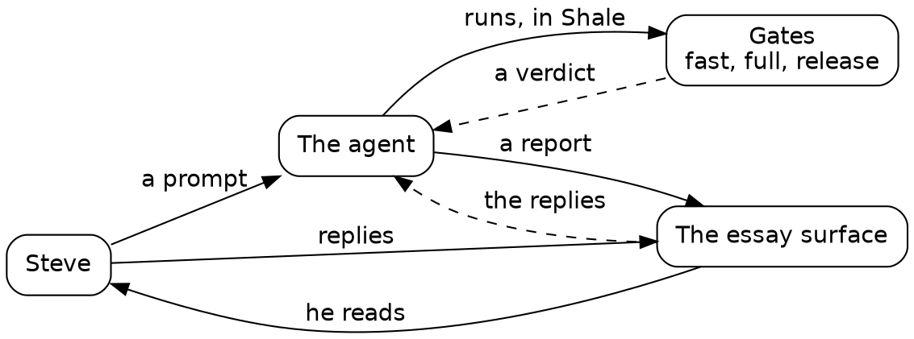
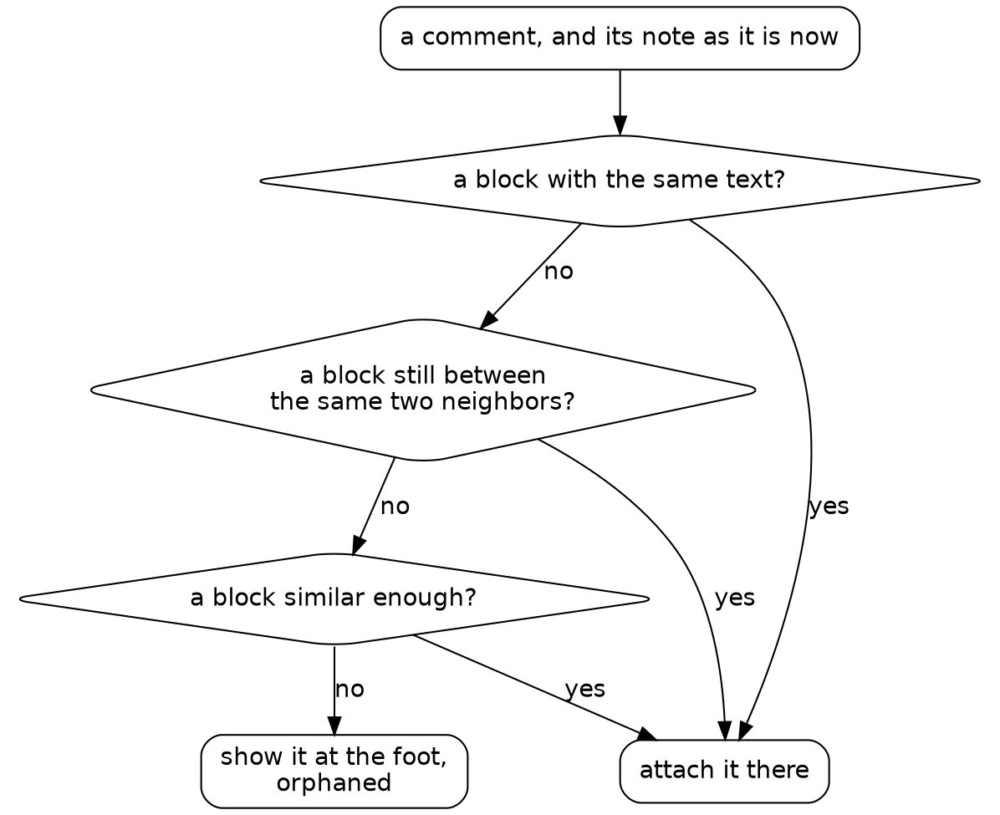
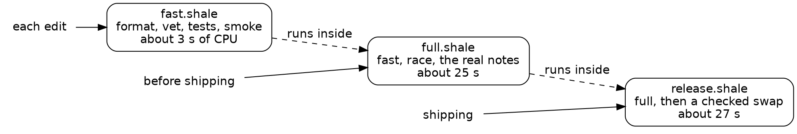
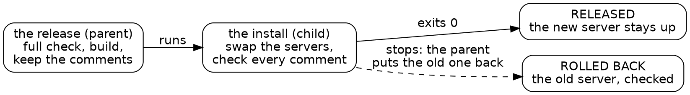

# Automating agentic development with Shale

A book for experienced developers who are new to working with agents. We follow one side project, a new essay surface built in a week of chapters, and read the Shale our agent wrote along the way.

This is draft 2, rough in places: prose and code, with pictures still to come.


## Introduction

Shale is a programming language written by agents, for agents. It looks like Lua on purpose, and it mostly works like any mainstream language: variables, functions, loops, lists and maps, strings and files. Its unique features are built for its niche, which is scripts an agent writes and a human reads.

That niche is the premise of this book. You will read a lot of Shale and write very little. Your agent writes it, every time it searches your code, runs your tests, renames across a tree or ships a release. You read it as it scrolls by, judge it, and steer the agent that wrote it. Here we learn to do that well.

### Who this book is for

This book is for experienced developers: people who have written plenty of code, but not much of it with an agent. You know a build from a test and a test from a gate. You may have tried an agent on a small task and wondered what it would take to trust one with a real project. You're curious about programming languages, and open to letting an agent do real work.

You won't need to install anything to follow along. Every script in the book really ran, and the book shows what it printed.

### The project

The book follows one side project from start to finish. We build a new essay surface: a small web app where an agent's notes, written in markdown, become pages, and Steve reads them in a browser and replies to any paragraph. (Monday's prompt says "where I write notes". In practice the agent writes them, and Steve reads and replies.) A Go server sits behind a plain-JavaScript front end. By the end of the week Steve was using it for real, and he wrote his replies to the drafts of this book on it.

We tell it as a week, a day per chapter, because that's how the work fell into stages. It's a side project, not five calendar days: the real build took an afternoon of agent time. An essay surface isn't an agent harness, though the two have something in common. In both, a human reads what was written, replies, and steers.

### We, and the prompts

The book says "we" for Steve and his agent. Each day opens with the prompt we gave the agent, quoted whole. Then it follows the work through the agent's own Shale, quoted from the journal the agent kept as it went. The agents were real, the prompts were real, and so were the mistakes. When something went wrong, the book says so, along with what caught it and what habit it taught.

### What Shale adds

Most of what you'll read is ordinary code. A few features are Shale's own:
- **Every run has budgets:** steps, reads and output. A runaway script stops and says which budget it hit.
- **A script works inside its own folder** and the named folders it mounts, so you can see everything it can reach.
- **A risky program runs when the script gives its reason.** A shell, an interpreter or a text tool needs a `want = "tag: why"`, and the reason is logged.
- **A stop is one line** that says where and why.
- **A prelude does the daily work:** git, jobs, HTTP, JSON, and refactors that read code the way its compiler does.

Shale builds nothing itself. `go build` makes the server. Shale runs the build, keeps what it said, and judges what came out.

### Gates

The thread through the whole week is gates. A gate is a script that holds work to a standard. It runs the checks, prints a verdict on its last line, and fails when the work falls short. Gates are how we write quality software with agents, because they turn a rule into something that runs on every change.

In this project, nobody planned the gates up front. They arrived when the work asked for them: a check before a commit on Monday, a fast check and a full one by Wednesday, faults planted on purpose on Thursday, a release with a rollback on Friday.

### A language that changes

Shale is meant to have dialects. A dialect costs a team of humans a great deal, because everyone has to learn it. It costs an agent very little, because an agent reads the whole script, and the docs for its own dialect. So you can keep the dialect that works for your agent, and build your own library of scripts on top of the cookbook or instead of it.

The week shows this happening. A nuisance came up four times, so on Saturday the language changed to fix it. For now, a reader who wants that freedom forks their own copy of Shale.

First, one turn of the loop, start to finish. Then Monday, with an empty repository and a prompt.

## One loop

Before the week begins, here's one complete turn of the loop the whole book is made of: an agent reports, Steve replies, the agent changes the code, and we read what it ran. It comes from Thursday, and it took a few minutes.



*The loop. Steve steers with prompts and replies, and the agent answers with code that has passed its gates, plus a report.*

### The report

At the end of Wednesday, the agent's report listed a few calls Steve might want to unmake. One said the server needs the comments folder's parent to exist when it starts. Steve read the report on the essay surface and replied to that paragraph. The reply landed in a file, one JSON line per reply, shown here trimmed to its main fields:

```text
{"name":"Steve","text":"add a defensive check","quote":"**The comments folder's parent must exist** when the server starts."}
```

That's the whole of the steering: four words, attached to the paragraph they answer. We passed it on to Thursday's agent in a short message.

### The change

The agent added the check in Go, where the server starts:

{{lines repos:essay-surface/store.go from "// The parent is checked, never made" to "is not a folder; make it"}}

Its comment says why: a mistyped folder name would otherwise grow a folder of comments where nobody looks. It added a test for a missing parent, a parent that's a file, and one that exists. Then it planted a fault once, saw the test go red, and took the fault out.

### What we read

Last, the agent ran the real server once with a folder that doesn't exist, to see the message where a person would meet it. This is what scrolled by:

{{fence repos:essay-surface/journal/thursday.md "what the real server says when the comments folder"}}

{{fence repos:essay-surface/journal/thursday.md "made: false"}}

Read it at scroll speed, with three questions:
- **What does it read?** One folder of notes, and whether `.run/no-such-folder` exists afterwards.
- **What does it run?** `./essay-surface`, the server it just built. Because that binary isn't tracked by git, `run` asks for a reason, and the script gives one: `want = "build: the server we just built"`.
- **How did it end?** Exit 1, with the message, and `made: false`: the server stopped and created nothing.

That took a few seconds, and it's enough to trust the change.

### Why Shale, and not bash

The same check in bash is one line: run the server, echo `$?`, list the folder. It works on a good day. On a bad day, when the check is missing, the server starts listening and never exits, and the agent's shell hangs on it. The Shale version can't hang. `run` requires a timeout, here 10 seconds, and a keep, here the last 5 lines. A program the repository doesn't track runs only with a reason, and the reason is logged. Every line of the script says what it touches, so the reader can judge it at a glance. That's the bargain the whole book rests on: slightly longer scripts that a human can read in seconds.

### The words we'll use

- **Agent:** an AI model working in a terminal on our behalf. It reads, runs programs and writes code.
- **Cold agent:** a fresh agent with no memory of our conversation, given one task and a written brief.
- **Prompt:** what we ask an agent to do, in plain words. Each day opens with one.
- **Heredoc:** a Shale script written inline in a shell command, `shale <<'EOF' … EOF`, run once.
- **Recipe:** a script saved to a file because its question came back.
- **Mount:** a named folder a script may reach beyond its own, written `name:path`.
- **Prelude:** Shale's built-in library for daily work: git, jobs, HTTP, JSON and refactors.
- **Job:** a program that outlives the call that started it, such as a server.
- **Gate:** a check that runs the tests and prints a verdict on its last line, and fails when the work falls short.
- **Fixture:** a small, permanent input a check must reject or accept.
- **Fault seeding:** putting a bug in once, on purpose, to prove a test catches it. We call these plants.
- **The old surface:** the essay surface Steve used before this week, a Python server.

## Monday: a server and a number

Our week starts with an empty repository and this prompt:

{{quote repos:essay-surface/journal/prompts/monday.md}}

The prompt has the roles turned around: in practice the agent writes the notes, and Steve replies to them. Two phrases shape the day. "Speed matters to me" asks for a number, and "five hundred notes" says where to measure it. Steve has about that many on the old surface, so the agent works against those.

### The first stop

The agent began by reading Shale's own docs, and its first script stopped:

{{fence repos:essay-surface/journal/monday.md "Before you reach"}}

{{fence repos:essay-surface/journal/monday.md "index 0 is outside the list"}}

A stop is one line: the place (line 7, column 28), a class (`index`), and the reason. At scroll speed, ask three questions of any script. What does it read? What does it run? How did it end? This one reads a doc, runs no programs, and ended at a stop. The cause is on its first line. `lines` splits a string, not a file, so `ls` held one line: the path itself. A file's lines are `read_lines`. The agent read the doc with its file reader instead, the right tool for prose.

### Budgets

To pick a dozen varied samples, the agent surveyed every real note, in the old surface's folder `essay-repl-server/notes`: its size, and how many fences, tables and list items it holds. The first try stopped on a budget:

{{fence repos:essay-surface/journal/monday.md "the step budget (5000000 steps) ran out"}}

Every Shale run has budgets for steps, reads, bytes and memory. `re_lines` is written in Shale itself, so it spends a step a character, and over 4.7 MB of notes the budget stopped the run long before it could run away. The agent switched to `grep`, a builtin, and hit the memory budget next. The docs give the fix: do each file's work in a function, and call `yield()` after each file, so the run holds one file at a time.

{{fence repos:essay-surface/journal/monday.md "wt = wt + 1" from "function measure(p)" to "print(#all"}}

This reads like Lua, on purpose. `function` declares a function, and `end` closes it. `{path = ..., bytes = ...}` is a map, `#` is a length, and `..` joins strings. `glob` lists files, and `stat` gives a file's size. The script reads the notes, runs no programs, and ended well:

{{fence repos:essay-surface/journal/monday.md "total bytes 4747688" from "502 notes" to "167408"}}

Five hundred was the real count, with a long tail: the biggest note is 167 KB. Smaller stops came all day, a guessed field name or builtin, each named in one line and fixed in the next call.

### A gate before a commit

The agent wrote the server and its renderer in Go. The first test run had one red, a table rule the agent chose to keep and wrote down as a test of its own. Then it saved its first recipe, `scripts/check.shale`: gofmt must list nothing, vet must be quiet, and every test must pass. Its first run stopped, which is its job:

{{fence repos:essay-surface/journal/monday.md "fail: gofmt (131 steps)"}}

Once the gate passed, the agent counted what ran, since a green is a claim:

{{fence repos:essay-surface/journal/monday.md "how many tests and subtests actually ran?"}}

`run` takes a program as a list of words, with a timeout and how much output to keep: here three minutes, and up to 200 KB. `must` turns a failed program into a failed script. Every program goes through `run` or a call like it, so programs are easy to spot at scroll speed. Seven top-level tests ran 69 cases, and none failed:

{{fence repos:essay-surface/journal/monday.md "PASS lines: 69"}}

Green again ✅

### The number

`job_start` runs a program that outlives one call, and `job_wait` watches its log for a line. The agent started the server and fetched the index. Its `want` gives the reason Shale asks for before running a program git doesn't track, like a server just built:

{{fence repos:essay-surface/journal/monday.md "start the server on the sample notes" from "job_start(" to "idx.ms"}}

The index came back in nine milliseconds:

{{fence repos:essay-surface/journal/monday.md "index 200, 3742 bytes, 9 ms" from "index 200" to "note 200"}}

That was the wrong number. `http_get` starts a curl process per call, so it timed curl starting up. The agent saved `scripts/bench.shale`, which runs one curl over many URLs on a kept-alive connection and reads curl's own clock. On all 503 real notes, a note takes about a tenth of a millisecond, and the index twenty times that:

{{fence repos:essay-surface/journal/monday.md "in 178ms" from "index: 200 requests" to "notes: 503 requests"}}

The agent split the index's 2 ms by phase with two Go benchmarks, and found 1.1 ms of it was a `stat` of every note on every request. It went first on tomorrow's list.

### The audit

The tests checked the cases the agent thought of. To find the rest, it rendered every real note through the server and counted markdown left over outside code. The first try stopped:

{{fence repos:essay-surface/journal/monday.md "budget runs: 64 programs a run"}}

Each `http_get` is a program, and a run gets 64. Worse, the stop came after `job_start`, so the server stayed up. Shale keeps a record of each job, a file named for its log plus `.job`, and the agent stopped the server by it:

{{fence repos:essay-surface/journal/monday.md "the job's record is <log>.job"}}

So the saved `scripts/audit.shale` fetches every page with one curl, stops the server, and only then lets `must` judge the fetch. It cuts code out of each page with builtins, which cost a step a call:

{{function repos:essay-surface/scripts/audit.shale cut}}

It ran in under a second and found two real bugs:

{{fence repos:essay-surface/journal/monday.md "<title>Review: gopher-roc"}}

Titles kept their markdown in 35 notes, and a lone triple backtick in a table cell swallowed the rest of its row. Each fix got a test, the table one copied from the note that found it. The audit of 503 real notes found two bugs that 62 hand-written renderer tests missed. The agent's verdict: write the audit before the tests next time.

### What's a check now

`check.shale` runs before every commit: gofmt, vet and every test. The audit's count is the next gate, once something proves the audit itself is watching.

## Tuesday: replies that stay put

Tuesday's prompt asks for the feature the surface exists for:

{{quote repos:essay-surface/journal/prompts/tuesday.md}}

As on Monday, the roles are turned around: the agent writes the notes and reads Steve's replies to steer its next draft. The first bullet is the hard one. The old surface stores a comment's place as a position, `"para_index": 4`, so a paragraph added above sends every comment below it one paragraph off. Today we also read the agent's scripts at review speed: it proposes to keep some of them, and for each we ask whether it earns its place.

### Arguing from real paragraphs

The obvious design: a comment remembers its paragraph's text, and on each render it goes to the most similar block above some threshold. The agent measured that before building it. A Go test scored every block of every real note against its nearest other block, and against itself after a typo, a changed word or a split. Scores are in thousandths, and p1 is the score the lowest 1% fall under:

{{fence repos:essay-surface/journal/tuesday.md "words: nearest other block" from "words: nearest other block" to "words: one typo"}}

One typo in a short block drops it to 250, while 1% of blocks have a look-alike in the same note at 714 or more. The two ranges overlap. A simulation of the decision itself showed the cost: with a second measure, trigrams, at a threshold of 300, low enough to keep edited short blocks, most deleted blocks hand their comments to a look-alike.

{{fence repos:essay-surface/journal/tuesday.md "trigrams deleted  T=300" from "trigrams deleted  T=300" to "trigrams deleted  T=300"}}

So the design added structure. A comment also remembers the fingerprints of the blocks before and after it. On each render it goes, in order, to the block with the same text, the block still between the same two neighbors, the most similar block, or the orphans at the foot of the page. A deleted block leaves its neighbors touching, so the second rule tells a deletion from an edit.

The first simulation of the real resolver ran past its 110-second timeout and was killed. A killed program has no exit code, only an `ended` that says why, so the script stopped on the line that read `code`:

{{fence repos:essay-surface/journal/tuesday.md "110.0 s in all"}}

The agent kept the timeout and found the waste: every simulated case recomputed the whole note. It cached each block's features once per note, then ran `go test` again with `env` pointing it at the real notes:

{{fence repos:essay-surface/journal/tuesday.md "precompute features once per note" from "local real = run(" to "real notes, ended"}}

With the word measure at a threshold of 600, every edit in place kept its comments, and 345 of 22,928 deleted paragraphs lent theirs to a look-alike:

{{fence repos:essay-surface/journal/tuesday.md "real notes, ended exit, 49158 ms" from "words    T=600 typo" to "words    T=600 deleted"}}

The trigram measure misplaced 635. The agent chose words because a wrong placement misleads, and an orphan is honest. The design was argued from Steve's own 22,900 paragraphs, and the comparison is committed as it ran, so anyone can run it again.



*How a reply finds its paragraph. Each rule is tried in turn, and a comment is never lost.*

### Seeding faults

Sixteen hand-written anchoring tests passed on their first run. To see whether they could fail, the agent broke the code twice, on purpose, and put it back each time:

{{fence repos:essay-surface/journal/tuesday.md "plant 1: no in-place rule"}}

`edit(path, old, new)` replaces text that must occur exactly once, so each break and each repair lands exactly where it says. Each `run` goes without `must`, since a red is the point. Each fault turned several tests red:

{{fence repos:essay-surface/journal/tuesday.md "--- FAIL: TestAnchorTypoFixed"}}

At review speed, this script is one-time: a fault left in place would prove nothing more. The agent did the same for the front end: `check.shale` now runs `node --check comments.js`, since `go test` never parses it, and one seeded syntax error turned that stage red.

### A script worth keeping

`scripts/comments_smoke.shale` runs the whole comment flow through the real server. It posts a comment, fixes a typo and adds a paragraph above it on disk while the server runs, then deletes the paragraph. Its checks go through one small function:

{{function repos:essay-surface/scripts/comments_smoke.shale want}}

The end of the script shows how it holds a server:

{{lines repos:essay-surface/scripts/comments_smoke.shale from "local job = essay_start(" to "for l in result.value do print(l) end"}}

`attempt` runs `flow` and gives back its result or its stop, so the server is stopped before any verdict. That is the review question for every script that starts a server, and `bench.shale` failed it once today. A budget stop is the one stop `attempt` can't catch, and the server stayed up until the agent stopped it by its job record. The budget line at the top of `bench.shale` now leaves room.

A run of the smoke test prints each check it passed, from the first post to the orphan:

{{fence repos:essay-surface/journal/tuesday.md "ok: and the file still has it"}}

Green again ✅

### Every check passed

The report's last item to check from now on was an eye test the agent couldn't run, since the box has no browser. Steve opened a note in his, and found no way to reply. The buttons sat at opacity 0 and appeared only on hover. On the old surface, reply buttons follow only prose paragraphs, so a button that appears on hover had him hunting for buttons that might not exist. His words: "Hover is an anti-feature."

The fix set the buttons at opacity 0.6. Their first label was "note", which already meant the essays, so a second commit made it "reply". Steve has written his real replies on the new surface ever since. The first landed on a bullet about "a rename pass", and it read back correctly from the comments file. On Thursday, hidden reply buttons become a check that runs without a browser.

### What's a check now

`check.shale` parses the front end and runs the anchoring simulation on the sample notes, its numbers held at what was measured, so any change to the anchoring shows its new numbers. The browser caught what every check missed, and that miss is the next check.

## Wednesday: a check for each moment

{{quote repos:essay-surface/journal/prompts/wednesday.md}}

By Wednesday the essay surface had four scripts, and Tuesday's report listed what to run and when. A list is something to remember. Today it became two commands.

### Measure, then listen

Monday's numbers had already named the cost: the index checked every note's file on every request. Before touching it, the agent measured the parts of its plan. One survey counted where the 505 real notes keep their dates: nearly always on line 3, in the paragraph after the title. Another timed `git log` on the notes at 0.8 s, slowed by 3,961 unpacked objects. That repository is Steve's, so the agent left it alone, and the server pays the cost once, at start-up.

The new server hears changes from the kernel, through Linux's inotify, and reads the kernel's queue of events at the start of each request. The kernel queues an event before the write returns, so the next request always sees it. The index page is kept until a note changes. Before, the index took fifteen times as long as a note:

{{fence repos:essay-surface/journal/wednesday.md "median 2.276 ms" from "index:" to "notes, no comments"}}

After, it took 0.1 ms, as fast as a note:

{{fence repos:essay-surface/journal/wednesday.md "median 0.105 ms, p90 0.143 ms" from "index:" to "notes, no comments"}}

A note's date now comes from its first lines, or else its last commit. A fresh clone, which resets every file's time, gives the same index, all 506 notes in place. That comparison became a stage of the full check.

The mistakes on the way stopped loudly. The prelude's `edit_between`, which replaces the text between two anchors, moved the store out of `server.go` and reported `-175 +3 lines`. That count showed it had cut the imports too, before anyone looked. A builtin the agent guessed at, `take_last`, stopped its script before a line ran.

### A check for each edit

`fast.shale` is the check Steve runs without thinking. Its body is five stages: the formatter, `go vet`, the front end's syntax, every Go test, and a smoke test through the real server:

{{lines repos:essay-surface/scripts/fast.shale from "local fmt = stage" to "checks through the real server"}}

The last two stages count what ran: "44 tests passed, 63 subtests" can be checked, and "ok" can't.

Each stage goes through one function, whose stop names the stage and its failed tests:

{{function repos:essay-surface/scripts/fast.shale stage}}

A run that spends more CPU than its `cpu_budget_ms` stops, naming the stage. The budgets are CPU time, never wall time: wall time on this two-CPU box doubles when something else is building, and the CPU a program spends barely moves. So a busy box can't turn the verdict red, and a stage gone slow can. A real run takes 2.4 s:

{{fence repos:essay-surface/journal/wednesday.md "5 programs, 2.4 s in all"}}

### A check before shipping

`full.shale` runs `fast.shale` first, then five stages on all of Steve's real notes: the Go tests under the race detector, Tuesday's anchoring simulation (which replays edits to see where comments land), Monday's audit of every rendered note, the dates comparison, and the bench. Every stage runs, even after one fails, so the last line names every stage that failed:

{{lines repos:essay-surface/scripts/full.shale from "local failed = {}" to "SAFE TO SHIP"}}

The bench needed more care, since its whole job is time. The server now logs, as it stops, how many requests it served and the CPU they took, so the bench holds each request's CPU to a budget:

{{lines repos:essay-surface/scripts/bench.shale from "The most CPU a request may take" to "const CPU_BUDGET_US"}}

The first version held one budget for the whole mix of requests, and the bench's 1,615 comment posts outweighed the rest: a return to the old scan would have added only about 125 µs to the average. So each phase got a server of its own. To prove the index budget, the agent put the old scan back once, and it measured 2,170 µs a request against the budget of 400. Wall-clock medians are still reported, and judged only when the box is quiet.

Slowness is a finding too. The anchoring simulation took 13 s, so the agent profiled it: the time was the work itself, 187,000 simulated edits, and it stays.

### The test that hid others

The store's new tests all passed on their first run. So the agent seeded a fault, a deaf watch: one line that made the server read nothing from the kernel's queue. Three tests went red, but every test that edits a note should have. The agent ran it again with the panic lines shown:

{{fence repos:essay-surface/journal/wednesday.md "slice bounds out of range [:-1] [recovered, repanicked]" from "slice bounds" to "0.042s"}}

Tuesday's `TestCommentsFollowEdits` sliced `page[:i]` with `i` at -1 when the page had no orphans section, where a deleted paragraph's comments go. The panic ended the test binary, and every test after it went unreported. Tuesday's run gave no sign, because on Tuesday nothing failed. With the panic made a plain failure, the same deaf watch turned twelve tests red. Thursday makes that trick a habit.

Then the full check went red on purpose: the renderer wrote `<b>` for `<strong>`, which looks the same on the page. The verdict was right, `NOT SAFE: fast, race failed`, but the red fast stage showed the last lines of `go test -v`, and those were passes. Now fast keeps only the failed tests and their lines, and its stop names them:

{{fence repos:essay-surface/journal/wednesday.md "1 failed: TestRender (86718 steps)" from "markdown_test.go:100" to "stopped at"}}

Monday's audit, which reads every rendered note for markdown left over, passed that fault, since it never checks which tags appear; the renderer's tests caught it. Each check has its own job.



*A check for each moment. Each runs the one before it, so a release has passed them all.*

### Now a gate

`fast.shale` runs on every edit, in about three seconds, and stops at the first failing stage, naming the failed tests. `full.shale` runs before anything ships, holds every stage to a CPU budget, and ends on one line: `SAFE TO SHIP`, or `NOT SAFE` and the stages that failed.

## Thursday: making the checks fail

{{quote repos:essay-surface/journal/prompts/thursday.md}}

Wednesday ended on `SAFE TO SHIP`. Could that line ever say anything else?

### One fault per stage

Thursday seeded one fault in each stage, a plant in our word, ran the stage, and took the fault out. Plants sometimes irritate Steve, because they slow gates, often through needless rebuilds. Done once and removed, they catch tests that test nothing, as Wednesday's deaf watch did.

`full.shale` has six stages, and its first, `fast`, has five of its own, so Thursday had eleven plants. Every launch had the same shape: the fault in (`OLD` becomes `NEW`), the stage run exactly as `full.shale` runs it, the fault out, then proof that the tree is back and `fast.shale` passes:

{{fence repos:essay-surface/journal/thursday.md "plant 1, fast's gofmt stage" from "OLD, NEW)" to "after: exit"}}

Each plant costs a rebuild and one run of its stage, from a few seconds to twenty, once. None was committed.

Every stage went red for its fault. The race detector caught a map read without its lock. The audit named the four real notes that a fault in aligned tables broke. The dates stage named one real note that a plausible "show the latest edit" change re-dated. The bench caught a cache kept but unused, at 1,776 µs of CPU a request against a budget of 400.

Three of those faults got past everything else. `fast` passed with the race in, and with the unused cache. Only the smoke test runs the real server binary, so its fault was invisible to the Go tests. The anchoring, audit and dates faults also tripped `fast`'s unit tests; those three stages earn their place on Steve's real notes.

### A stop with the fault still in

Plant 6's first launch gave `run` a CPU budget but no stage name for its stop to report. Shale stopped the script between the fault going in and coming out, leaving it in `store.go`. The agent removed it first:

{{fence repos:essay-surface/journal/thursday.md "the last launch stopped after planting"}}

Plants 1 to 5 had been lucky: a stop in any of them would have left its fault behind too. After that, every plant ran under `shale --undo-on-stop`, which puts back every file a stopped run changed. The next try stopped on a mistake in the agent's own `print`, and Shale's last line shows the undo:

{{fence repos:essay-surface/journal/thursday.md "undone: 1 path(s) the run changed put back"}}

### Green with the fault in

The fourth plant wrote a commenter's name to the page without escaping it. The tests checked the comment's text, and nothing checked the name, so `fast` passed:

{{fence repos:essay-surface/journal/thursday.md "ok  test, 2474 ms" from "ok  test" to "fast: PASS"}}

That is a real security hole: a commenter named `<script>...` would run code on every reader's page, and every stage of the full check passed with it. The agent wrote the missing test, which puts markup in every field the page shows:

{{fence repos:essay-surface/journal/thursday.md "func TestEveryCommentFieldEscaped"}}

It passed before the plant, failed with it, and passed after: green again ✅. The smoke's plant found a smaller flaw: its red said only that a file was missing, and now it names the check that failed.

### Fixtures, and what they cost

Three kinds of fixture stayed, each one data the check reads. The audit reads a known-bad page and a known-good one before any real note, in under 5 ms, and a plant that blinded the audit stopped it there, before any server started. Wednesday's hidden panic became data for the part of `fast.shale` that reads `go test` output:

{{lines repos:essay-surface/scripts/fast.shale from "A known-bad go test -v output" to "misreads testdata"}}

It costs 3 ms, and a plant that stopped the reader from recognizing a panic tripped it at once. The third kind is the reply-button sheets, below.

The rest of the plants proved their stages once and left. A known-bad Go file would turn `gofmt` and `vet` red forever unless the checks skipped it, and a skip that broad would hide real faults too. A racy program needs a `-race` build of its own, exactly the cost Steve named. A slow fixture for the bench needs a server.

### Reply buttons, without a browser

On Tuesday every check passed, and Steve opened a page with no visible way to reply: the buttons sat at `opacity:0` until hovered. `buttons_test.go` works out the CSS cascade itself, on the stylesheet the page is served with. It judges each place `comments.js` puts a button, at every width a media query names, light and dark. A button counts as hidden under `display:none`, `visibility:hidden`, or opacities that multiply out to under 0.5. CSS it can't judge, such as `!important`, stops the test. It never runs the script, and it misses clipping and contrast.

Its fixtures are seven small sheets, five known-bad and two known-good, at 0.02 s inside `go test`. Tuesday's is the real one, from git:

{{fence repos:essay-surface/journal/thursday.md "the known-bad and known-good sheets for the reply-button check" from "testdata/buttons/tuesday.css" to "faint-article.css"}}

Putting Tuesday's `opacity:0` back turned the test red at widths of 51 and 80rem. The checker got a plant of its own, opacities no longer multiplied, and `faint-article.css` caught it:

{{fence repos:essay-surface/journal/thursday.md "faint-article.css: want" from "--- FAIL" to "faint-article.css: want"}}

### Steve's two replies

Two replies to Wednesday's report arrived mid-run. The first asked for a defensive check that the comments folder's parent exists. The server already failed there, but by accident. Now it checks first, names the path, and makes nothing:

{{fence repos:essay-surface/journal/thursday.md "made: false"}}

The second put phones out of scope. The README says so in one sentence, and the by-hand list keeps only the desktop browser. The narrow-window CSS stays: out of scope means unchecked, not removed.

`full.shale` went from 30.9 s to 23.3 s, mostly from a quieter box; Thursday's additions cost tens of milliseconds.

### Now a gate

Every stage of `full.shale` has been seen red once, and its kept fixtures run on every check in milliseconds. A page that hides its reply buttons fails `fast.shale` now, and so does a commenter's name that reaches the page unescaped.

## Friday: shipping should be boring

{{quote repos:essay-surface/journal/prompts/friday.md}}

By Friday the surface was in daily use, with real replies on it, and every release was a chore done by hand. A chore done by hand is done a little differently each time. A release done by a script is the same every time, and that sameness is what we mean by boring.

### A release, in order

The agent's `release.shale` follows the prompt, in order. It stops before it touches anything unless the checkout is clean and exactly one server runs with the command line it would start. Then it runs Thursday's full check, and goes on only if the check exits 0 and its last line says SAFE TO SHIP:

{{lines repos:essay-surface/scripts/release.shale from "-- 2: the full check." to "full check: SAFE TO SHIP"}}

Next, `go build` makes the new binary beside the old one, and the script writes down the commit it came from and how long the build took.

Before it stops anything, the script copies the comments into a dated folder and compares the copy file by file. It also saves the old server's index and its commented pages, as a record of where each comment sat. Then it stops the old server, keeps its binary as `.prev`, starts the new one, and checks it. The comment check is strict: each comment must follow the same block of the note as before, and still be in its file.

The swap and the checks run under `attempt`, which catches a failure and hands it back as a value, so a failed check leads to the rollback:

{{show repos:essay-surface 92fb48b:scripts/release.shale from "local done = attempt(rel_install_and_check, t, before)" to "ROLLED BACK: running"}}

On a failure, the old binary goes back and gets the same checks the new one failed. A failed release ends where it started, and says so on its last line.

### A check that talked to the wrong server

The first surprise came before the script ran at all. The trial put an "old" server on the dev port, 9300, and the checks' own servers listened there too. Run beside it, the smoke check (a few requests through a server of its own) failed, and its log shows why:

{{fence repos:essay-surface/journal/friday.md "the page: 404" from "── stopped at" to "bind: address"}}

The smoke's server logged "listening", then failed to bind, and the smoke went on to ask the trial server for its test page. Every script waited for "listening", and the server said it before the port was its own. This time the check failed; against a different server, it could have passed. Two fixes followed: `server.go` now binds first and says "listening" after, and the checks moved to port 9310, named once in the prelude.

### The trap, sprung

On Monday, the agent noted a trap: a run that stops after `job_start` leaves its server running. Friday's first trial sprang it. Every Shale script runs under a budget, a cap on its steps, and this one ran out just after the swap:

{{fence repos:essay-surface/journal/friday.md "the step budget (5000000 steps) ran out" from "stopped the old server" to "ran out"}}

`attempt` catches a failure, and a budget stop is past its reach. The run stopped after the old server was down and the new one was up, so the rollback never ran. The trial was left serving a build nobody had checked. On the live server, that would have been an unchecked release with no way back but by hand, which is how the agent put the trial back.

The cause was a regex over a 67 KB page, at a step a character; plain `split` and `find` now read the pages. The defense was a step budget twenty times what a release uses. The trap itself stayed in the language until Saturday.

### A release that fails on purpose

The prompt asked for a release that fails, and the agent chose its fault carefully. A fault the full check catches never reaches the swap, so it proves nothing about the rollback. It needed a fault no check covers, and found one in the server's defaults. Every check passes `-comments` explicitly. The live server passes none. So the agent seeded one fault, on a throwaway branch in its own git worktree, that moves the default comments folder inside the notes folder:

{{fence repos:essay-surface/journal/friday.md "*comments = filepath.Join(filepath.Clean(*dir)"}}

The full check said SAFE TO SHIP. The release caught it on the first comment and put the old server back, checked the same way:

{{fence repos:essay-surface/journal/friday.md "FAILED: comment f31eaaa22556" from "started abacae9" to "ROLLED BACK"}}

Afterward every comments file matched the data byte for byte, and the bad binary was kept as `.failed`, with its log. That's the case for a release check: the full check tests the server the way the tests start it, and the release check tests it the way it really runs, with its real flags and data.

A fourth trial seeded a formatting fault, and the full check stopped it: `nothing touched`, the same server pids before and after. Then the agent removed the seeded fault's branch and worktree, since a seeded fault proves a check once.

### The real release

When it worked on dev, we ran it ourselves on the live server. It shipped, with every comment where it was:

```text
release: /home/steve/essay-dogfood on 127.0.0.1:9301
running: pid 2484343, unknown (built before release.shale)
…
full check: SAFE TO SHIP, 26562 ms
built bin/essay-surface.new: 92fb48b built 2026-11-13T17:51:07Z: Journal: Friday, the final script released once more on dev, 926 ms
comments kept: 3 files, 7 comments, in essay-dogfood/releases/2026-11-13T175107Z/comments, each compared
stopped the old server; its log kept
started 92fb48b built 2026-11-13T17:51:07Z: Journal: Friday, the final script released once more on dev
ok: the index, 508 notes, the same as before
…
ok: all 7 comments from before on their pages and in their files
RELEASED: running 92fb48b on 127.0.0.1:9301; to roll back to unknown: cd /home/steve && shale repos:essay-surface/scripts/release.shale data=essay-dogfood port=9301 rollback=1
```

Read it the way you'd read any gate: the verdicts. The full check passed, the build took under a second, seven comments were kept and found where they were, and the last line says what runs and how to go back. The old version reads `unknown` because it was built by hand. The full check is nearly all of the 27 seconds; the swap and its checks fit inside one. Green again ✅

The release was the most boring thing we did all week, and it took the most care to make it so. Boring is what a release looks like when every surprise was found on the dev port first.

## Saturday: the language gets better

Four times this week, an agent's run stopped after `job_start` and left a server running: on Monday, on Tuesday, on Thursday while seeding a fault, and in Friday's first trial, on a budget stop. Each time, someone noticed and cleaned up by hand.

Four times is a pattern, and a pattern of hand cleanup is a gap in the language. So on Saturday we closed it, in Shale itself.

### The rule

The rule fits in one sentence: a run that stops ends the jobs it started. A `fail`, an error or a budget, anything but the script's own end, stops each job that run started and that still runs. A run that ends normally leaves its jobs running, because a server started on purpose should stay up. A failure that `attempt` catches is no stop, since the run goes on.

Some jobs must outlive even a stop, so `job_start` gained one option, `keep_on_stop`. Here is the prelude's `job_start` as it stands now, with the comment that tells an agent about both:

{{function repos:shale/src/shale_prelude_linux.shale job_start}}

When a run stops, its report says what happened to each job, in one line apiece. These two are from a live run that stopped with two jobs up, one of them kept:

```text
── stopped with the run, 1 job it started: `sleep 31` (log scratch:keep-test.7WQsc0/plain.log)
── left running (keep_on_stop): `sleep 30` (log scratch:keep-test.7WQsc0/kept.log)
```

That's the same shape as every stop in this book: one line, what happened, and where to look.

### How it arrived

A cold agent built it. Shale's interpreter is written in Zig, so the feature is Zig too: the interpreter keeps a list of the jobs a run starts, and ends the ones still running when the run stops. The tests cover every side of the rule. A run that ends keeps its job. A failed run ends both of its jobs and names them. A budget stop ends its job. A caught failure ends nothing. A `keep_on_stop` job survives the stop and is named apart. A job the run already stopped or waited for gets no second stop. A job another run started is never touched. Two faults seeded into the feature turned those tests red, so the tests are watching.

Then the feature passed Shale's own tests and the consumers gate, Shale's gate that runs the checks of every repository built on it. A change to what a stop means touches every script with a job in it, so that gate is the one that matters. It passed, and we merged it.

### The code says what it keeps

The feature changed what a stop does, and one script had to say something new. A failed release ends with `fail`, which is a stop. It ends that way on purpose, after it has put the old server back and checked it. Under the new rule, that stop would end the old server too. So `release.shale` gained one word:

{{function repos:essay-surface/scripts/release.shale rel_start}}

The new server starts with `keep` false, and the old one put back by a failed release starts with it true. Before Saturday, the script's defense against the trap was a large step budget and a comment explaining it. Now the code says which server stays, and the language does the rest.

The feature also exposed a gap in Friday's script. A budget stop after the swap would now end the new server with the run, and the run could never put the old one back. A script can't catch its own stop, so the release runs the swap and its checks as a child run, a second Shale process it can watch:

{{function repos:essay-surface/scripts/release.shale rel_install_child}}

A child that stops just exits nonzero, its new server ends with it, and the parent, still running, puts the old server back. We proved it with a runaway loop planted in the child's checks: the budget stopped the child, the old server came back, and both test comments were on its page.

One limit remains. A `shale` killed from outside, by Ctrl-C or by a timeout around it, never reaches its own stop, so its jobs run on. That's why the release script's opening comment asks for a long timeout on the call that runs it.



*The release as a parent and a child. Whatever stops the child, the parent is still running to put the old server back.*

### Dialects

This is what we mean by a language that agents make better. The feature came from the week's own work. The work needed it four times, the nuisance had a clear shape, and an agent turned it into a rule, its tests and a one-line report.

`keep_on_stop` went into Shale's main line, since every project with a server wants it. In your own fork, a word like it is where your dialect begins. A dialect costs a human a great deal: new words to learn, old habits that no longer fit. It costs an agent very little, since the agent reads the docs every session. So Shale is meant to have dialects. Each reader keeps the one that works for their agent, and builds their own scripts on top of it.

For now, that means forking your own copy of Shale and letting your agent change it. The habit matters more than the mechanism. When a cleanup happens by hand a second time, ask your agent what word the language is missing. Then read the tests on both sides, see the seeded faults turn them red, and run the gates of everything that depends on it.

The best feature of the week came from its most annoying chore. Your agent's nuisances are your language's roadmap.

## How we work

A week of work leaves habits behind. Here they are in one place, since they're the real subject of the book.

### Three ways to read

Most of the Shale you'll meet goes by quickly. Read it at three speeds:
- **At scroll speed,** a script going by: what does it read, what does it run, and how did it end? A Shale script names every program it runs, and its stop is one line, so a few seconds is enough.
- **At review speed,** a script the agent wants to keep: is it worth having again? Read its code, not its opening comment. Check its arguments, the way it fails, and its last line, which is its claim about what it did.
- **At trust speed,** a gate: what does it hold, how does its count stay honest, and what proves it's watching? A gate you've never seen fail is a gate you haven't tested.

### A check for each moment

By Friday the project had a check for every moment, each sized to how often it runs:

| When | The check | Its time |
|---|---|---|
| each edit | `fast.shale`: format, vet, the tests, a smoke test | about 3 s of CPU |
| before shipping | `full.shale`: fast, the race detector, the real notes | about 25 s |
| shipping | `release.shale`: full, then a checked swap with a rollback | about 27 s |

A check that's too slow stops getting run, so each one is held to a budget, and the budget is CPU time, which a busy machine can't break.

### Prove it can fail

Every gate on the list earned its place by failing once on purpose. On Wednesday a planted fault found a test whose panic hid twelve others. On Thursday one found a security hole that every stage had passed. Seeding faults costs a few minutes, once. Keep as permanent fixtures only the cheap ones: data a check reads, never something that needs a build of its own.

### Measure a baseline

After the week, Shale gained Go hunts, built on Go's own parser: names, nesting and code smells, each proved by its fixtures. Run over essay-surface, they found little. There were no vague function names and nothing nested four calls deep. Two long functions in the markdown renderer, `inline` and `link`, are the next refactor if one is wanted. A hunt that finds little in good code is still worth running: it sets the baseline, and the next change gets held to it.

### Look with your own eyes

Every check passed on Tuesday, and the reply buttons were invisible. Gates hold what you already know to check. A human's first look finds what you didn't know yet, and then the agent can often turn it into a gate.

### Let the work ask

Nothing this week was planned in advance. The checks, the release script and the language change all arrived because a chore came up more than once. That's how to grow a project's tools: make a script the third time you do something by hand, a gate once the script makes a judgment, and a change to the language once its gap starts to cost you.

### Your dialect

That last step is the one most languages don't offer. Shale changes as its agents work, and yours can too. Fork it, keep the dialect your agent works best in, and build your own library of recipes. The scripts in this book are a starting point. The ones your agent writes for your own work will be better.
