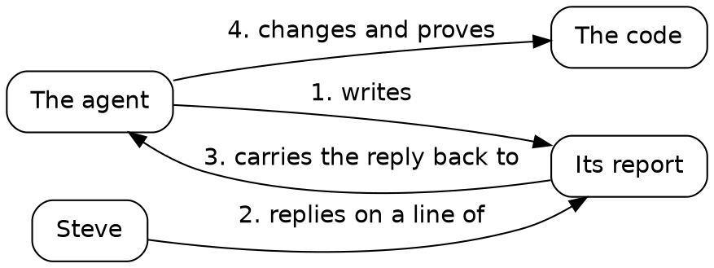

# Draft

## One loop

Before the sessions, here's one complete turn of the loop this book is made of, from the middle of Session 4. It took the agent a few minutes, and it took Steve four words.

*One turn of the loop, from Session 4. Each arrow reads as a sentence, in order: the agent writes its report.*

### The agent writes its report

The agent ended Session 3 with a report on the essay surface. One line in it named a decision Steve might want to reverse: "**The comments folder's parent must exist** when the server starts."

### Steve replies on a line

Steve replied to that line, in four words: "add a defensive check".

Reply where the context is. The line carries everything the agent needs to know about what you mean, so four words are a complete instruction. A reply in a chat window would have to restate it.

### The reply goes back to the agent

The orchestrator, the agent that coordinates the others, passed the reply to the agent already at work on Session 4.

### The agent changes and proves the code

The agent added the check in Go, where the server starts:

{{lines repos:essay-surface/store.go from "// The parent is checked, never made" to "is not a folder; make it"}}

Its comment says why: a mistyped folder name would grow a folder of comments where nobody looks. The agent wrote a test for three cases, a missing parent, a parent that's a file, and one that's there. Then it planted a fault once: it took its own check out, watched the test go red, and put the check back. The commit check passed.

You know the change is right without reading the Go. The test says what the code must do, the planted fault proves the test can fail, and the gate says everything else still holds.

That's the loop the rest of the book runs, session after session: steer by replying where the context is, and let the agent prove what it changed.
