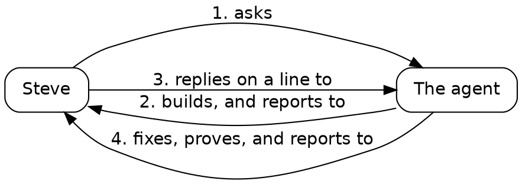

# Draft

## One loop

Before the sessions, here's the loop every piece of work in this book runs: Steve asks the agent for something, the agent builds it and reports, Steve replies on a line of the report, and the agent fixes what he pointed at. Here is one real turn, from Session 3 into Session 4.

*One turn of the loop. Read each arrow as a sentence, in order: Steve asks the agent.*

### Steve asks the agent

In Session 3, Steve asked for a faster index and for a way to run the project's checks at the right moment, "so nobody has to remember the list."

### The agent builds, and reports to Steve

The agent built both, and ended with a report on the essay surface: what it built, and a list of calls it had made on its own, for Steve to confirm or change. One of them read: "**The comments folder's parent must exist** when the server starts."

### Steve replies on a line to the agent

Steve replied on that line, in four words: "add a defensive check".

Reply where the context is. The line carries the context, so four words make a complete instruction: stop at start, with one clear message naming the path, and leave the folder unmade. In a chat window, you'd have to quote the line first.

### The agent fixes, proves, and reports to Steve

The agent added the check in Go, where the server starts:

{{lines repos:essay-surface/store.go from "// The parent is checked, never made" to "is not a folder; make it"}}

Its comment says why: a mistyped `-comments` path would grow a folder of comments where nobody looks. The agent wrote a test for three cases: a missing parent, a parent that's a file, and a parent that exists. Then it seeded a fault, once: it took its own check out, watched the test fail, and put the check back. Then the check before every commit passed, and the next report told Steve it was done.

Judge a change by its proof: a test that says what the code must do, a fault seeded once to show the test can fail, and a gate that's green.

Once the surface can take replies, every session runs this loop. It begins, in Session 1, with a new repository.
