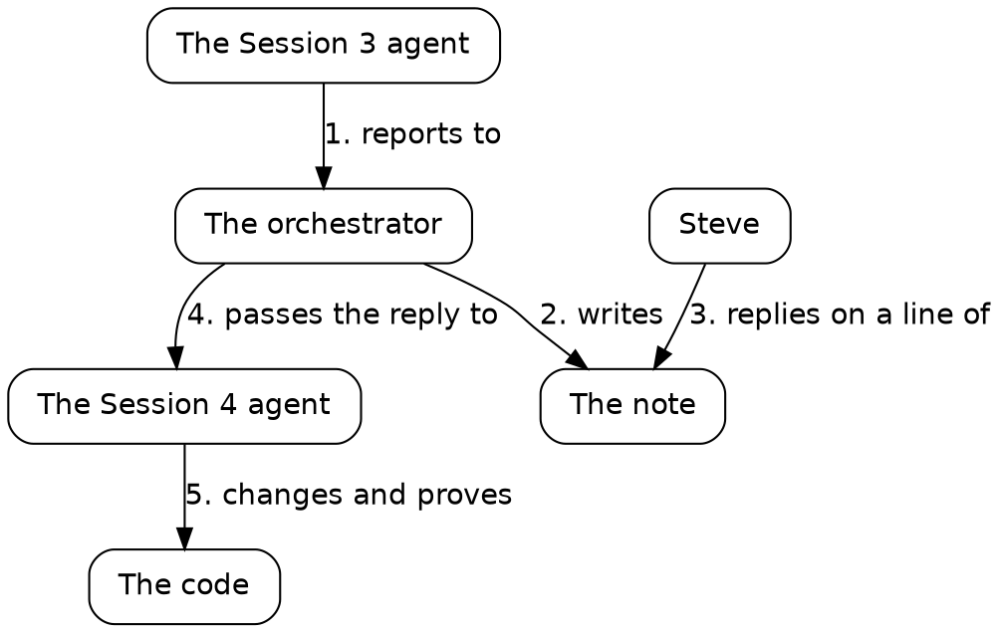

# Draft

## One loop

Before the sessions, here's one complete turn of the loop they run once the essay surface can take replies, taken from the middle of Session 4. From Steve's reply to the commit took under five minutes, and it took Steve four words.

*One turn of the loop, from Session 4. Read each arrow as a sentence, in order: the Session 3 agent reports to the orchestrator.*

### The Session 3 agent reports to the orchestrator

The Session 3 agent ended its session with a report: what it built, and the decisions it made on its own, for Steve to confirm or change.

### The orchestrator writes a note

The orchestrator, the agent that coordinates the others, turned that report into a note on the essay surface, where Steve reads. One line of it said: "**The comments folder's parent must exist** when the server starts."

### Steve replies on a line of the note

Steve replied on that line, in four words: "add a defensive check".

Reply where the context is. The line carries the context, so four words make a complete instruction. In a chat window, you'd have to quote the line first.

### The orchestrator passes the reply to the Session 4 agent

By then the Session 4 agent was at work. The orchestrator passed it the reply, with its line, and spelled out what the four words meant: stop at start, with one clear message naming the path, and leave the folder unmade. That's the orchestrator's part in the loop. It holds the context on both sides, so Steve's reply can stay short.

### The Session 4 agent changes and proves the code

The agent added the check in Go, where the server starts:

{{lines repos:essay-surface/store.go from "// The parent is checked, never made" to "is not a folder; make it"}}

Its comment says why: a mistyped `-comments` path would grow a folder of comments where nobody looks. The agent wrote a test for three cases: a missing parent, a parent that's a file, and a parent that exists. Then it seeded a fault, once: it took its own check out, watched the test fail, and put the check back. Then the check before every commit passed.

Judge a change by its proof: a test that says what the code must do, a fault seeded once to show the test can fail, and a gate that's green.

Once the surface can take replies, every session runs this loop. It begins, in Session 1, with a new repository.
