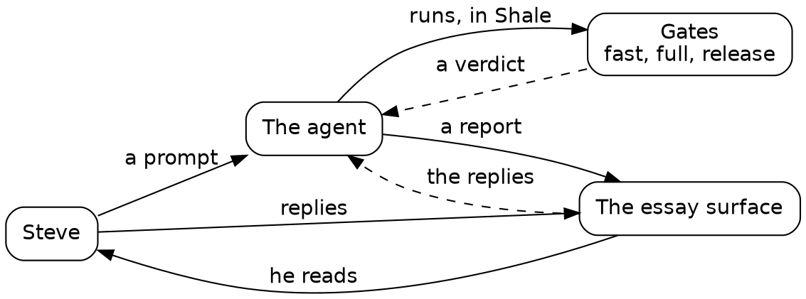

# Draft

## One loop

Before the first session, here's one complete turn of the loop the whole book is made of: an agent reports, Steve replies, the agent changes the code, and we read what it ran. It comes from Session 4, and it took a few minutes.



*The loop. Steve steers with prompts and replies, and the agent answers with code that has passed its gates, plus a report.*

### The report

At the end of Session 3, the agent's report listed a few calls Steve might want to unmake. One said the server needs the comments folder's parent to exist when it starts. Steve read the report on the essay surface and replied to that paragraph. The reply landed in a file, one JSON line per reply, shown here trimmed to its main fields:

```text
{"name":"Steve","text":"add a defensive check","quote":"**The comments folder's parent must exist** when the server starts."}
```

That's the whole of the steering. Attach each reply to the paragraph it answers: the paragraph carries the context, so four words are a complete instruction. The agent Steve talks to, the orchestrator, passed it on to the next session's agent in a short message.

### The change

The agent added the check in Go, where the server starts:

{{lines repos:essay-surface/store.go from "// The parent is checked, never made" to "is not a folder; make it"}}

Its comment says why: a mistyped folder name would otherwise grow a folder of comments where nobody looks. It added a test for a missing parent, a parent that's a file, and one that exists. Then it planted a fault once, saw the test go red, and took the fault out.

### What we read

Last, the agent ran the real server once with a folder that doesn't exist, to see the message where a person would meet it. This is what scrolled by:

{{fence repos:essay-surface/journal/thursday.md "what the real server says when the comments folder"}}

{{fence repos:essay-surface/journal/thursday.md "made: false"}}

Read every script that goes by at scroll speed, with three questions. A few seconds a script is what lets you judge an agent's work as fast as it runs:
- **What does it read?** One folder of notes, and whether `.run/no-such-folder` exists afterwards.
- **What does it run?** `./essay-surface`, the server it just built. Because that binary isn't tracked by git, `run` asks for a reason, and the script gives one: `want = "build: the server we just built"`.
- **How did it end?** Exit 1, with the message, and `made: false`: the server stopped and created nothing.

That took a few seconds. It shows the check working where a person would meet it, and the test and the planted fault cover the rest.

### Why Shale, and not bash

The same check in bash is one line: run the server, echo `$?`, list the folder. It works on a good day. On a bad day, when the check is missing, the server starts listening and never exits, and the agent's shell hangs on it. The Shale version stops waiting: `run` requires a timeout, here 10 seconds, and a keep, here the last 5 lines. A program the repository doesn't track runs only with a reason, and the reason is logged. Every line of the script says what it touches, so the reader can judge it at a glance. That's the bargain the whole book rests on: slightly longer scripts that a human can read in seconds.

### The words we'll use

- **Agent:** an AI model working in a terminal on our behalf. It reads, runs programs and writes code.
- **Cold agent:** a fresh agent with no memory of our conversation, given one task and a written brief.
- **Orchestrator:** the agent Steve talks to, acting as his proxy. It writes the prompts, briefs the cold agents and checks their work.
- **Prompt:** what we ask an agent to do, in plain words. Each session opens with one.
- **Heredoc:** a Shale script written inline in a shell command, `shale <<'EOF' … EOF`, run once.
- **Recipe:** a script saved to a file because its question came back.
- **Mount:** a named folder a script may reach beyond its own, written `name:path`.
- **Prelude:** Shale's built-in library for daily work: git, jobs, HTTP, JSON and refactors.
- **Job:** a program that outlives the call that started it, such as a server.
- **Gate:** a check that runs the tests and prints a verdict on its last line, and fails when the work falls short.
- **Fixture:** a small, permanent input a check must reject or accept.
- **Fault seeding:** putting a bug in once, on purpose, to prove a test catches it. We call these plants.
- **The old surface:** the essay surface Steve used before this project, a Python server.
- **Session:** one stretch of work that opens with one prompt, and a chapter of this book.
