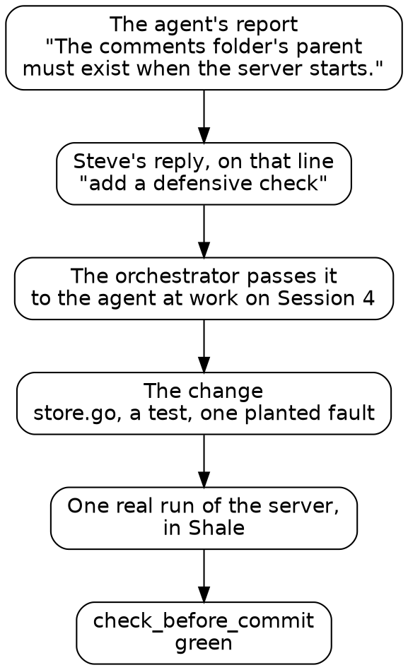

# Draft

## One loop

Before the sessions, here's one complete turn of the loop this book is made of, from the middle of Session 4. It took the agent a few minutes, and it took Steve four words.

*One turn of the loop, from Session 4.*

### The report and the reply

The agent ended Session 3 with a report on the essay surface. One line in it named a decision Steve might want to reverse: "**The comments folder's parent must exist** when the server starts." Steve replied to that line, in four words: "add a defensive check".

Reply where the context is. The line carries everything the agent needs to know about what you mean, so four words are a complete instruction. A reply in a chat window would have to restate it.

### The handoff

By then the agent for Session 4 was already at work. The orchestrator, the agent that coordinates the others, passed Steve's reply to it mid-run, and the agent folded it into its session.

### The change, and how you know it's right

The agent added the check in Go, where the server starts:

{{lines repos:essay-surface/store.go from "// The parent is checked, never made" to "is not a folder; make it"}}

Its comment says why: a mistyped folder name would grow a folder of comments where nobody looks. The agent wrote a test for three cases, a missing parent, a parent that's a file, and one that's there. Then it planted a fault once: it took its own check out, watched the test go red, and put the check back. The commit check passed.

You know the change is right without reading the Go. The test says what the code must do, the planted fault proves the test can fail, and the gate says everything else still holds.

### What scrolls by

Last, the agent ran the real server once, with a folder that's missing, to see the message where a person would meet it. This script went by:

{{fence repos:essay-surface/journal/session-4.md "what the real server says when the comments folder"}}

Read it at scroll speed, with three questions:
- **What does it read?** One folder of notes, and whether `.run/no-such-folder` exists afterward.
- **What does it run?** `./essay-surface`, the server it just built. Git doesn't track that binary, so `run` asks for a reason, and the script gives one: `want = "build: the server we just built"`.
- **How did it end?** The agent read the output and said so in its report: the server stopped at start with one message naming the path, and left the folder unmade.

### Two habits

This turn holds the two habits the rest of the book builds on. Steer by replying where the context is. Read the scripts, and let the agent read their output. The sessions that follow are this loop, run again and again, with the gates growing each time.
