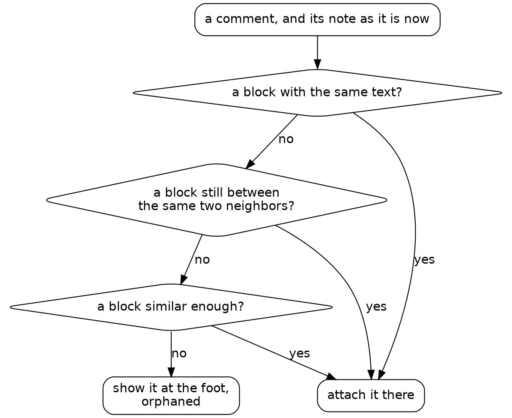

# Draft

## Session 2: replies that stay put

The second prompt asks for the feature the surface exists for:

{{quote repos:essay-surface/journal/prompts/tuesday.md}}

As in the first prompt, the roles are turned around: the agent writes the notes and reads Steve's replies to steer its next draft. The first bullet is the hard one. The old surface stores a comment's place as a position, `"para_index": 4`, so a paragraph added above sends every comment below it one paragraph off. This time we also read the agent's scripts at review speed: it proposes to keep some of them, and for each we ask whether it earns its place.

### Arguing from real paragraphs

The obvious design: a comment remembers its paragraph's text, and on each render it goes to the most similar block above some threshold. The agent measured that before building it. A Go test scored every block of every real note against its nearest other block, and against itself after a typo, a changed word or a split. Scores are in thousandths, and p1 is the score the lowest 1% fall under:

{{fence repos:essay-surface/journal/tuesday.md "words: nearest other block" from "words: nearest other block" to "words: one typo"}}

One typo in a short block drops it to 250, while 1% of blocks have a look-alike in the same note at 714 or more. The two ranges overlap. A simulation of the decision itself showed the cost: with a second measure, trigrams, at a threshold of 300, low enough to keep edited short blocks, most deleted blocks hand their comments to a look-alike.

{{fence repos:essay-surface/journal/tuesday.md "trigrams deleted  T=300" from "trigrams deleted  T=300" to "trigrams deleted  T=300"}}

So the design added structure. A comment also remembers the fingerprints of the blocks before and after it. On each render it goes, in order, to the block with the same text, the block still between the same two neighbors, the most similar block, or the orphans at the foot of the page. A deleted block leaves its neighbors touching, so the second rule tells a deletion from an edit.

The first simulation of the real resolver ran past its 110-second timeout and was killed. A killed program has no exit code, only an `ended` that says why, so the script stopped on the line that read `code`:

{{fence repos:essay-surface/journal/tuesday.md "110.0 s in all"}}

The agent kept the timeout and found the waste: every simulated case recomputed the whole note. It cached each block's features once per note, then ran `go test` again with `env` pointing it at the real notes:

{{fence repos:essay-surface/journal/tuesday.md "precompute features once per note" from "local real = run(" to "real notes, ended"}}

With the word measure at a threshold of 600, every edit in place kept its comments, and 345 of 22,928 deleted paragraphs lent theirs to a look-alike:

{{fence repos:essay-surface/journal/tuesday.md "real notes, ended exit, 49158 ms" from "words    T=600 typo" to "words    T=600 deleted"}}

The trigram measure misplaced 635. The agent chose words because a wrong placement misleads, and an orphan is honest. The design was argued from Steve's own 22,900 paragraphs, and the comparison is committed as it ran, so anyone can run it again.

*How a reply finds its paragraph. Each rule is tried in turn, and a comment is never lost.*

### Seeding faults

Sixteen hand-written anchoring tests passed on their first run. To see whether they could fail, the agent broke the code twice, on purpose, and put it back each time:

{{fence repos:essay-surface/journal/tuesday.md "plant 1: no in-place rule"}}

`edit(path, old, new)` replaces text that must occur exactly once, so each break and each repair lands exactly where it says. Each `run` goes without `must`, since a red is the point. Each fault turned several tests red:

{{fence repos:essay-surface/journal/tuesday.md "--- FAIL: TestAnchorTypoFixed"}}

At review speed, this script is one-time: a fault left in place would prove nothing more. The agent did the same for the front end: `check.shale` now runs `node --check comments.js`, since `go test` never parses it, and one seeded syntax error turned that stage red.

### A script worth keeping

`scripts/comments_smoke.shale` runs the whole comment flow through the real server. It posts a comment, fixes a typo and adds a paragraph above it on disk while the server runs, then deletes the paragraph. Its checks go through one small function:

{{function repos:essay-surface/scripts/comments_smoke.shale want}}

The end of the script shows how it holds a server:

{{lines repos:essay-surface/scripts/comments_smoke.shale from "local job = essay_start(" to "for l in result.value do print(l) end"}}

`attempt` runs `flow` and gives back its result or its stop, so the server is stopped before any verdict. That is the review question for every script that starts a server, and `bench.shale` failed it once in this session. A budget stop is the one stop `attempt` can't catch, and the server stayed up until the agent stopped it by its job record. The budget line at the top of `bench.shale` now leaves room.

A run of the smoke test prints each check it passed, from the first post to the orphan:

{{fence repos:essay-surface/journal/tuesday.md "ok: and the file still has it"}}

Green again ✅

### Every check passed

The report's last item to check from now on was an eye test the agent couldn't run, since the box has no browser. Steve opened a note in his, and found no way to reply. The buttons sat at opacity 0 and appeared only on hover. On the old surface, reply buttons follow only prose paragraphs, so a button that appears on hover had him hunting for buttons that might not exist. His words: "Hover is an anti-feature."

The fix set the buttons at opacity 0.6. Their first label was "note", which already meant the essays, so a second commit made it "reply". Steve has written his real replies on the new surface ever since. The first landed on a bullet about "a rename pass", and it read back correctly from the comments file. In Session 4, hidden reply buttons become a check that runs without a browser.

### What's a check now

`check.shale` parses the front end and runs the anchoring simulation on the sample notes, its numbers held at what was measured, so any change to the anchoring shows its new numbers. The browser caught what every check missed, and that miss is the next check.
