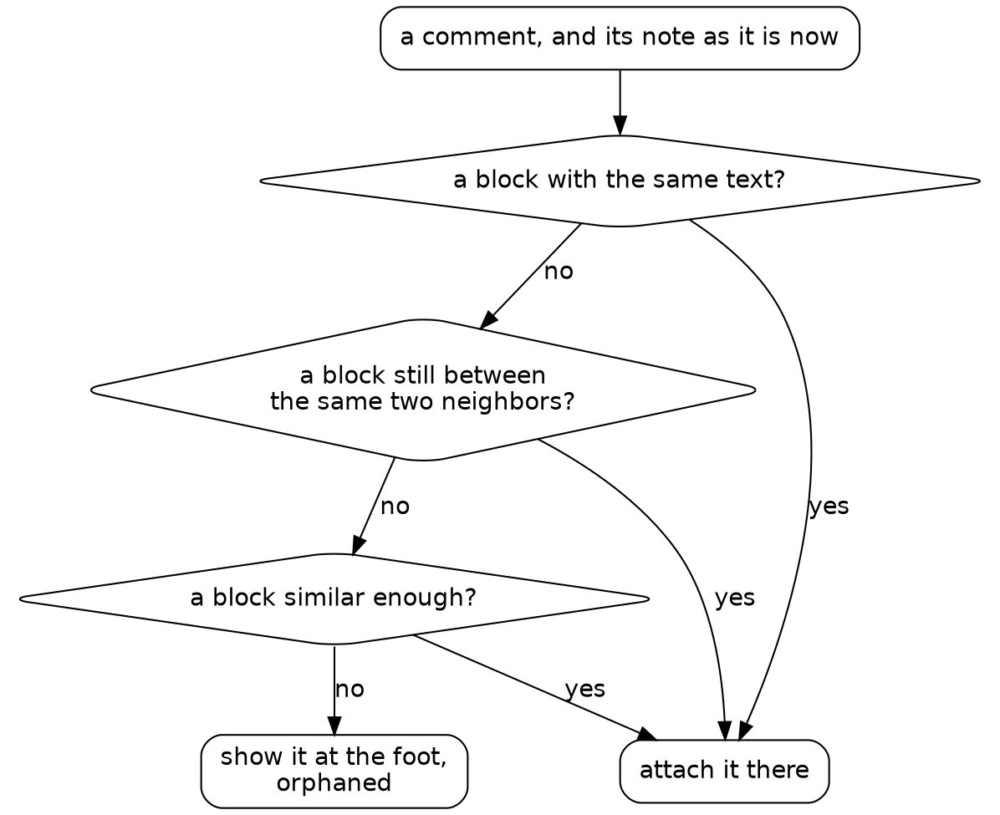

# Draft

## Session 2: replies that stay put

Session 2 asks for the feature the surface exists for:

{{quote repos:essay-surface/journal/prompts/session-2.md}}

A cold agent took this prompt and worked for about half an hour. Steve stepped in once, after looking at the result in his browser, and the orchestrator made that fix.

The first bullet is the hard one. The old surface stores a comment's place as a position, `"para_index": 4`, so a paragraph added above sends every comment below it one paragraph off.

### A reply finds its paragraph

A reply belongs to a paragraph, and it has to find that paragraph again after the note changes. The obvious design remembers the paragraph's text and, on each render, picks the most similar block. The agent tried that idea on Steve's real notes before building it, and it failed: a short block with one typo can look less like itself than another block looks like its neighbor, so a deleted paragraph would hand its replies to a look-alike.

So the design added structure. A comment also remembers the fingerprints of the blocks before and after it. On each render it goes, in order, to the block with the same text, the block still between the same two neighbors, the most similar block, or the orphans at the foot of the page. A deleted block leaves its neighbors touching, so the second rule tells a deletion from an edit.

*How a reply finds its paragraph. Each rule is tried in turn, and a comment is never lost.*

The first simulation of the real resolver panicked, on a block the agent's own test code removed twice. The second ran past its timeout and was killed. A killed program has no exit code, only an `ended` that says why, so the script stopped on the line that read `code`:

{{fence repos:essay-surface/journal/session-2.md "110.0 s in all"}}

The agent kept the timeout and found the waste: every simulated case recomputed the whole note. Its first cache went onto each case's copy of the note and was thrown away with it, so the third run timed out too. With each block's features cached once per note, the simulation ran over all of Steve's paragraphs. It deletes each real paragraph in turn, and 345 of those 22,928 deletions lent their comments to a look-alike; every edit in place kept its comments. The agent compared two measures of similarity and chose the one that misplaced fewer. When a guess can be wrong, prefer an honest failure to a confident wrong answer: an orphan at the foot of the page tells Steve to look, and a reply on the wrong paragraph misleads him.

### Seeding faults

Sixteen hand-written anchoring tests passed on their first run. To see whether they could fail, the agent broke the code twice, on purpose, and put it back each time. That's fault seeding, also called mutation testing, and we call each seeded fault a plant:

{{fence repos:essay-surface/journal/session-2.md "plant 1: no in-place rule"}}

`edit(path, old, new)` replaces text that must occur exactly once, so each break and each repair lands exactly where it says. Each `run` goes without `must`, since a red is the point. Each fault turned several tests red:

{{fence repos:essay-surface/journal/session-2.md "--- FAIL: TestAnchorTypoFixed"}}

This script is for one use: a fault proves its point in a single run. The agent did the same for the front end: `check.shale` now runs `node --check comments.js`, since `go test` never parses it, and one seeded syntax error turned that stage red.

### A script worth keeping

Some of the agent's scripts get a read at review speed, the slower read a script gets when the agent proposes to keep it: does it earn its place? `scripts/check_comment_flow.shale` runs the whole comment flow through the real server. It posts a comment, fixes a typo and adds a paragraph above it on disk while the server runs, then deletes the paragraph. Its checks go through one small function:

{{function repos:essay-surface/scripts/check_comment_flow.shale want}}

The end of the script shows how it holds a server:

{{lines repos:essay-surface/scripts/check_comment_flow.shale from "local job = essay_start(" to "for l in result.value do print(l) end"}}

`attempt` runs `flow` and gives back its result or its stop, so the server is stopped before any verdict. That is the review question for every script that starts a server, and `measure_server.shale` failed it once in this session. Its run on all the real notes stopped on its budget for what a run keeps at each `yield`:

{{fence repos:essay-surface/journal/session-2.md "bench.shale:140:5"}}

A budget stop is the one stop `attempt` can't catch, so the server stayed up until the agent stopped it by its job record. The bench's budget line now leaves room.

A run of the smoke test prints each check it passed, from the first post to the orphan:

{{fence repos:essay-surface/journal/session-2.md "ok: and the file still has it"}}

Green again ✅

### Every check passed

The report's last item was an eye test, a look at a page in a browser, that the agent couldn't run, since its machine has no browser. Steve opened a note in his own, and found no way to reply. The buttons sat at opacity 0 and appeared only on hover. His words: "Hover is an anti-feature."

The fix set the buttons at opacity 0.6. Their first label was "note", which already meant the essays, so a second commit made it "reply". Steve has written his real replies on the new surface ever since. In Session 4, hidden reply buttons become a check that runs without a browser.

### The gates now

`check.shale` parses the front end and runs the anchoring simulation on the sample notes, its numbers held at what was measured. The browser caught what every check missed. Turn each miss into a check, so the same miss can't get past you twice.
