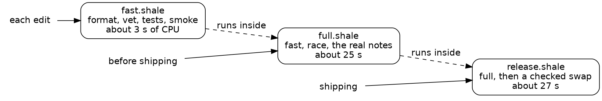

# Draft

## Session 3: a check for each moment

{{quote repos:essay-surface/journal/prompts/wednesday.md}}

A cold agent worked for about half an hour on this one, and Steve didn't step in.

By now the essay surface had four scripts, and the last session's report listed what to run and when. A list is something to remember. This session made it two commands.

### An index that listens

The first session's bench had named the cost: the index checked every note's file on every request. The new server hears changes from the kernel, through Linux's inotify, and reads the kernel's queue of events at the start of each request. The kernel queues an event before the write returns, so the next request always sees it. The index page is kept until a note changes, and the agent measured it at about the cost of a note.

A note's date now comes from its first lines, or else its last commit. A fresh clone, which resets every file's time, gives the same index, and that comparison became a stage of the full check.

The mistakes on the way stopped loudly. The prelude's `edit_between`, which replaces the text between two anchors, moved the store out of `server.go` and reported `-175 +3 lines`. That count showed it had cut the imports too, before anyone looked.

### A check for each edit

`fast.shale` is the check Steve runs without thinking. Its body is five stages: the formatter, `go vet`, the front end's syntax, every Go test, and a smoke test through the real server:

{{lines repos:essay-surface/scripts/fast.shale from "local fmt = stage" to "checks through the real server"}}

The last two stages count what ran: "44 tests passed, 63 subtests" can be checked, and "ok" can't.

Each stage goes through one function, whose stop names the stage and its failed tests:

{{function repos:essay-surface/scripts/fast.shale stage}}

A run that spends more CPU than its `cpu_budget_ms` stops, naming the stage. The budgets are CPU time, never wall time: wall time on this two-CPU machine doubles when something else is building, and the CPU a program spends barely moves. So a busy machine can't turn the verdict red, and a stage gone slow can. A real run takes 2.4 s:

{{fence repos:essay-surface/journal/wednesday.md "5 programs, 2.4 s in all"}}

### A check before shipping

`full.shale` runs `fast.shale` first, then five stages on all of Steve's real notes: the Go tests under the race detector, the anchoring simulation from Session 2 (which replays edits to see where comments land), the audit of every rendered note from Session 1, the dates comparison, and the bench. Every stage runs, even after one fails, so the last line names every stage that failed:

{{lines repos:essay-surface/scripts/full.shale from "local failed = {}" to "SAFE TO SHIP"}}

The bench needed more care, since its job is time. The server now logs, as it stops, the CPU its requests took, so the bench holds each kind of request to a CPU budget, about twice what real notes took:

{{lines repos:essay-surface/scripts/bench.shale from "const CPU_BUDGET_US" to "const CPU_BUDGET_US"}}

One budget for the whole mix hid a slow index under the many comment posts, so each kind got a server of its own. The old scan, put back once, broke the index's budget more than five times over.

Slowness is a finding too. The anchoring simulation took 13 s, so the agent profiled it: the time was the work itself, 187,000 simulated edits, and it stays.

### The test that hid others

The store's new tests all passed on their first run. So the agent seeded a fault, a deaf watch: one line that made the server read nothing from the kernel's queue. Three tests went red, but every test that edits a note should have. The agent ran it again with the panic lines shown:

{{fence repos:essay-surface/journal/wednesday.md "slice bounds out of range [:-1] [recovered, repanicked]" from "slice bounds" to "0.042s"}}

`TestCommentsFollowEdits`, written in Session 2, sliced `page[:i]` with `i` at -1 when the page had no orphans section, where a deleted paragraph's comments go. The panic ended the test binary, and every test after it went unreported. Its runs in Session 2 gave no sign, because nothing failed then. With the panic made a plain failure, the same deaf watch turned twelve tests red. After seeding a fault, count how many tests went red against how many should have, because a test that panics hides every test after it. The next session makes that trick a habit.

Then the full check went red on purpose: the renderer wrote `<b>` for `<strong>`, which looks the same on the page. The verdict was right, `NOT SAFE: fast, race failed`, but the red fast stage showed the last lines of `go test -v`, and those were passes. Now fast keeps only the failed tests and their lines, and its stop names them:

{{fence repos:essay-surface/journal/wednesday.md "1 failed: TestRender (86718 steps)" from "markdown_test.go:100" to "stopped at"}}

The audit, which reads every rendered note for markdown left over, passed that fault, since it never checks which tags appear; the renderer's tests caught it. Each check has its own job.

*A check for each moment. Each runs the one before it, so a release has passed them all.*

### Now a gate

`fast.shale` runs on every edit, in about three seconds, and stops at the first failing stage, naming the failed tests. `full.shale` runs before anything ships, holds every stage to a CPU budget, and ends on one line: `SAFE TO SHIP`, or `NOT SAFE` and the stages that failed.
