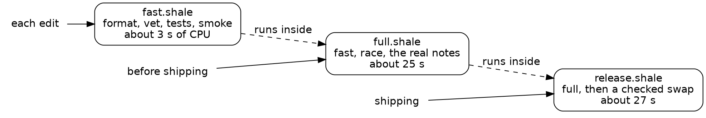

# Draft

## Session 5: shipping should be boring

Session 5 turns a chore into a script:

{{quote repos:essay-surface/journal/prompts/friday.md}}

A cold agent built the release script and proved it on a dev port, away from the live server, in about sixteen minutes. Steve didn't step in, and the orchestrator ran the real release.

By now the surface was in daily use, with real replies on it, and every release was a chore done by hand. A script runs the same steps in the same order each time, and that sameness is what we mean by boring.

### A release, in order

The agent's `release.shale` follows the prompt, in order. Before it touches anything, it checks that the checkout is clean and that exactly one server runs with the command line it would start. Then it runs the full check, and goes on only if the check exits 0 and its last line says SAFE TO SHIP:

{{lines repos:essay-surface/scripts/release.shale from "-- 2: the full check." to "full check: SAFE TO SHIP"}}

Then it builds the new binary beside the old one, copies the comments into a dated folder and compares the copy file by file, swaps the servers, and checks the new one. The comment check is strict: each comment must follow the same block of the note as before. The swap and the checks run under `attempt`, which catches a failure and hands it back as a value, so a failed check leads to the rollback:

{{show repos:essay-surface 92fb48b:scripts/release.shale from "local done = attempt(rel_install_and_check, t, before)" to "ROLLED BACK: running"}}

A failed release puts the old binary back, checks it the same way, and says so on its last line.

### A check that talked to the wrong server

The first surprise came before the release script was written. The agent set up a trial with an "old" server on the dev port, 9300, and the checks' own servers listened there too. Run beside it, as a trial release would run it, the smoke check (a few requests through a server of its own) failed, and its log shows why:

{{fence repos:essay-surface/journal/friday.md "the page: 404" from "── stopped at" to "bind: address"}}

The smoke's server logged "listening", then failed to bind, and the smoke went on to ask the trial server for its test page. Every script waited for "listening", and the server said it before the port was its own. Announce readiness only after you hold the resource, because whatever waits on the announcement acts on it at once. This time the check failed; against a different server, it could have passed. Two fixes followed: `server.go` now binds first and says "listening" after, and the checks moved to port 9310. That port is named once, in the project's own prelude: a project can add a prelude beside Shale's, a file of helpers its scripts share.

### The trap, sprung

In the first session, the agent noted a trap: a run that stops after `job_start` leaves its server running. This session's first trial sprang it. This one ran out of its step budget just after the swap:

{{fence repos:essay-surface/journal/friday.md "the step budget (5000000 steps) ran out" from "stopped the old server" to "ran out"}}

`attempt` catches a failure, and a budget stop is past its reach. The run stopped after the old server was down and the new one was up, so the rollback never ran. The trial was left serving a build nobody had checked. On the live server, that would have been an unchecked release with no way back but by hand, which is how the agent put the trial back.

The cause was a regex search over a 67 KB page, which pays for its whole pattern at every byte it examines; plain `split` and `find` now read the pages. The defense was a step budget twenty times what a release uses. The trap itself stayed in the language until the next session.

### A release that fails on purpose

The prompt asked for a release that fails. A fault the full check catches never reaches the swap, so it proves nothing about the rollback. The agent needed a fault no check covers, and found one in the server's defaults. Every check passes `-comments` explicitly. The live server passes none. So the agent seeded one fault, on a throwaway branch in its own git worktree, that moves the default comments folder inside the notes folder:

{{fence repos:essay-surface/journal/friday.md "*comments = filepath.Join(filepath.Clean(*dir)"}}

The full check said SAFE TO SHIP. The release caught it on the first comment and put the old server back, checked the same way:

{{fence repos:essay-surface/journal/friday.md "FAILED: comment f31eaaa22556" from "started abacae9" to "ROLLED BACK"}}

Afterward every comments file matched byte for byte, and the bad binary was kept with its log. That's the case for a release check: the full check tests the server the way the tests start it, and the release check tests it the way it really runs, with its real flags and data.

Another trial seeded a formatting fault, and the full check stopped it: `nothing touched`, the same server pids before and after. Then the agent removed the seeded fault's branch and worktree, since a seeded fault proves a check once.

### The real release

When it worked on dev, the orchestrator ran it on the live server. The agent's report kept its last lines:

{{fence repos:essay-repl-server/notes/essay-surface-friday.md "RELEASED: running 92fb48b" from "full check: SAFE TO SHIP" to "RELEASED: running"}}

Read it the way you'd read any gate: the verdicts. The full check passed, the build took under a second, seven comments were kept and found where they were, and the last line says what runs and how to go back. Green again ✅

### The gates now

`release.shale` is the third gate: the full check, then the live server held to the same checks, with a rollback on any failure. With it, the project has a check for each moment:

*A check for each moment. Each runs the one before it, so a release has passed them all.*

The real release was boring because this session's surprises, the wrong server and the budget stop, were found on the dev port first.

Along the way, Steve asked the orchestrator to watch for a nuisance that Shale itself could fix.
