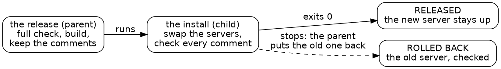

# Draft

## Session 6: the language gets better

Four times in five sessions, an agent's run stopped after `job_start` and left a server running: in each of the first two, again while seeding faults in Session 4, and in the first release trial, on a budget stop. Each time, someone noticed and cleaned up by hand.

Four times is a pattern, and a pattern of hand cleanup is a gap in the language. So this session closed it, in Shale itself.

### The rule

The rule fits in one sentence: a run that stops ends the jobs it started. A `fail`, an error or a budget, anything but the script's own end, stops each job that run started and that still runs. A run that ends normally leaves its jobs running, because a server started on purpose should stay up. A failure that `attempt` catches is no stop, since the run goes on.

Some jobs must outlive even a stop, so `job_start` gained one option, `keep_on_stop`. Here is the prelude's `job_start` as it stands now, with the comment that tells an agent about both:

{{function repos:shale/src/shale_prelude_linux.shale job_start}}

When a run stops, its report says what happened to each job, in one line apiece. These two are from a live run that stopped with two jobs up, one of them kept:

```text
── stopped with the run, 1 job it started: `sleep 31` (log scratch:keep-test.7WQsc0/plain.log)
── left running (keep_on_stop): `sleep 30` (log scratch:keep-test.7WQsc0/kept.log)
```

That's the same shape as every stop in this book: one line, what happened, and where to look.

### How it arrived

A cold agent built it. Shale's interpreter is written in Zig, so the feature is Zig too: the interpreter keeps a list of the jobs a run starts, and ends the ones still running when the run stops. The tests cover every side of the rule. A run that ends keeps its job. A failed run ends both of its jobs and names them. A budget stop ends its job. A caught failure ends nothing. A `keep_on_stop` job survives the stop and is named apart. A job the run already stopped or waited for gets no second stop. A job another run started is never touched. Two faults seeded into the feature turned those tests red, so the tests are watching.

Then the feature passed Shale's own tests and the consumers gate, Shale's gate that runs the checks of every repository built on it. A change to what a stop means touches every script with a job in it, so that gate is the one that matters. It passed, and we merged it.

### The code says what it keeps

The feature changed what a stop does, and one script had to say something new. A failed release ends with `fail`, which is a stop. It ends that way on purpose, after it has put the old server back and checked it. Under the new rule, that stop would end the old server too. So `release.shale` gained one word:

{{function repos:essay-surface/scripts/release.shale rel_start}}

The new server starts with `keep` false, and the old one put back by a failed release starts with it true. Before this session, the script's defense against the trap was a large step budget and a comment explaining it. Now the code says which server stays, and the language does the rest.

The feature also exposed a gap in the release script itself. A budget stop after the swap would now end the new server with the run, and the run could never put the old one back. A script can't catch its own stop, so the release runs the swap and its checks as a child run, a second Shale process it can watch:

{{function repos:essay-surface/scripts/release.shale rel_install_child}}

A child that stops just exits nonzero, its new server ends with it, and the parent, still running, puts the old server back. We proved it with a runaway loop planted in the child's checks: the budget stopped the child, the old server came back, and both test comments were on its page.

One limit remains. A `shale` killed from outside, by Ctrl-C or by a timeout around it, never reaches its own stop, so its jobs run on. That's why the release script's opening comment asks for a long timeout on the call that runs it.



*The release as a parent and a child. Whatever stops the child, the parent is still running to put the old server back.*

### Dialects

This is what we mean by a language that agents make better. The feature came from the project's own work. The work needed it four times, the nuisance had a clear shape, and an agent turned it into a rule, its tests and a one-line report.

`keep_on_stop` went into Shale's main line, since every project with a server wants it. In your own fork, a word like it is where your dialect begins. A dialect costs a human a great deal: new words to learn, old habits that no longer fit. It costs an agent very little, since the agent reads the docs every session. So Shale is meant to have dialects. Each reader keeps the one that works for their agent, and builds their own scripts on top of it.

For now, that means forking your own copy of Shale and letting your agent change it. The habit matters more than the mechanism. When a cleanup happens by hand a second time, ask your agent what word the language is missing. Then read the tests on both sides, see the seeded faults turn them red, and run the gates of everything that depends on it.

The best feature so far came from the most annoying chore. Your agent's nuisances are your language's roadmap.
