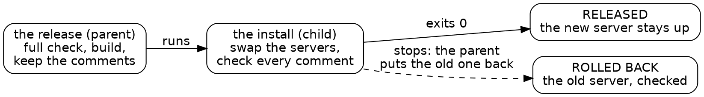

# Draft

## Session 6: the language gets better

Session 6 opens with a reply:

*Steve's reply, in conversation*

> go ahead with the jobs feature

This session began from a reply in conversation, not from a written prompt. During Session 5, Steve asked the orchestrator to watch for a nuisance that Shale itself could fix, and it found one. Three times in five sessions, an agent's run stopped after `job_start` and left a server running: in each of the first two, and in the first release trial, on a budget stop. Each time, someone noticed and stopped it by hand. Session 4 had a cousin of the trap: a stop between a fault going in and coming out left the fault in the tree, and `--undo-on-stop` already covered files.

Three times is a pattern, and a pattern of hand cleanup is a gap in the language. So right after Session 5, a cold agent closed it in Shale itself, in about sixteen minutes. Steve's reply came the next morning, and the merge followed. He stepped in once more, to choose the child run below from three options.

### The rule

The rule fits in one sentence: a run that stops ends the jobs it started. A `fail`, an error or a budget, anything but the script's own end, stops each job that run started and that still runs. A run that ends normally leaves its jobs running, because a server started on purpose should stay up. A failure that `attempt` catches is no stop, since the run goes on.

Some jobs must outlive even a stop, so `job_start` gained one option, `keep_on_stop = true`.

When a run stops, its report says what happened to each job it started, in one line apiece: stopped with the run, or left running. These two lines end a release that failed on purpose in this session's trials, after it had put the old server back with `keep_on_stop`:

{{fence repos:essay-surface/journal/saturday.md "plant: a budget stop in the child's checks" from "── stopped at" to "── left running"}}

### How it arrived

The design is small: each run keeps a list of the jobs it starts, and a stop ends the ones still running. The tests cover every side of the rule: a run that ends, a failed run, a budget stop, a caught failure, a `keep_on_stop` job, a job already stopped, and a job another run started.

After Steve's reply, the orchestrator ran Shale's own tests and the consumers gate, Shale's gate that runs the checks of every repository built on it. When you change what a primitive means, run the gates of everything built on it: a new meaning for a stop reaches every script with a job in it. It passed, and the orchestrator merged it.

### The code says what it keeps

The feature changed what a stop does, and one script had to say something new. A failed release ends with `fail`, which is a stop. It ends that way on purpose, after it has put the old server back and checked it. Under the new rule, that stop would end the old server too. So `release.shale` gained one word:

{{lines repos:essay-surface/scripts/release.shale from "function rel_start(t, keep)" to "local job = job_start(rel_argv(t)"}}

The new server starts with `keep` false, and the old one put back by a failed release starts with it true. Before, a large step budget and a comment were its only defense. Now the code says which server stays, and the language does the rest.

The feature also exposed a gap in the release script itself. A budget stop after the swap would now end the new server with the run, and the run could never put the old one back. Put recovery in a process that outlives the failure. A script can't catch its own stop, so the release runs the swap and its checks as a child run, a second Shale process it watches:

{{lines repos:essay-surface/scripts/release.shale from "function rel_install_child(t, before)" to "return {ok = true, lines = own}"}}

A child that stops just exits nonzero, its new server ends with it, and the parent, still running, puts the old server back. We proved it with a runaway loop planted in the child's checks: the budget stopped the child, the old server came back, and both test comments were on its page.

One limit remains. A `shale` killed from outside, by Ctrl-C or by a timeout around it, never reaches its own stop, so its jobs run on. That's why the release gets a long timeout, 300 seconds, on the call that runs it.

*The release as a parent and a child. Whatever stops the child, the parent is still running to put the old server back.*

### Dialects

This is a dialect arriving, at the price Meet Shale gave. The work needed the rule three times, the nuisance had a clear shape, and an agent turned it into a rule, its tests and a one-line report. The next agent to start a job meets `keep_on_stop` in the docs it reads anyway.

`keep_on_stop` went into Shale's main line, since every project with a server needs it. A word only your project needs belongs in your own fork, and that's where your dialect begins. For now, that means forking your own copy of Shale and letting your agent change it. When a cleanup happens by hand a third time, ask your agent what word the language is missing. Your agent's nuisances are your language's roadmap.

### The gates now

Shale's own tests hold the rule on every side, and the consumers gate holds every project built on Shale to it. `release.shale` runs its swap as a child, so even a budget stop mid-check ends with the old server back.
