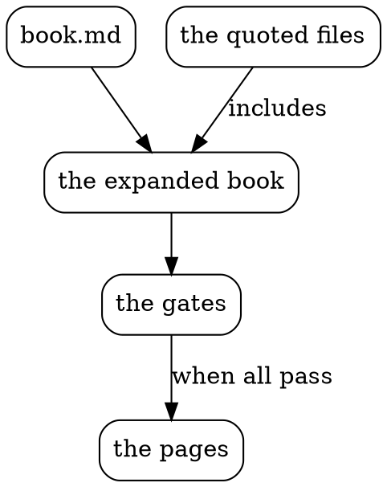
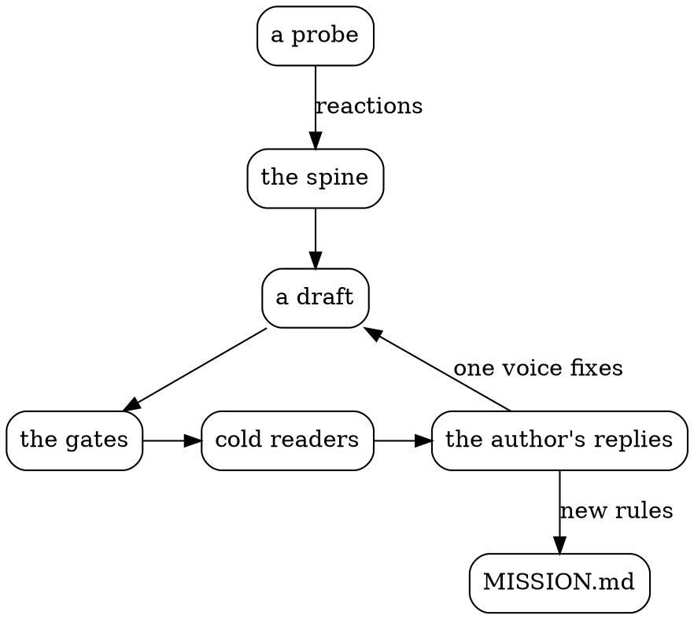

# Building a Book with Claude and Shale

This is a short how-to manual for building a book with Claude Code as the writer and a small build system that turns markdown into a checked, published website. You stay the editor: you set the rules, read the drafts and reply, and the agent writes.

Steve Howell writes programs in Roc and builds tools for working with agents. With Claude Code writing and Steve editing, he built the [Safari Ride book](https://roc.lynrummy.com/tutorial/), which teaches Roc through one real program. This book is its companion. It explains how that book was made, and a smaller copy of the same machinery builds it.

### Who it's for, and what you need

- **Claude Code.** The agent does the writing, the setup and the builds.
- **Linux on x86-64.** [Shale](https://github.com/showell/shale), the scripting language the builds run in, supports that platform, and this book covers setup on it alone.
- **Permission to install software.** Setup installs Graphviz with your package manager, which asks for sudo.
- **A GitHub account, for later.** Cloning works anonymously. You'll want an account to fork a builder and to publish your book on GitHub Pages.
- **Curiosity about the machinery.** You'll read Shale scripts as they scroll by, and the agent writes them.

A passing familiarity with Roc helps with the Safari examples, and your own book can be about anything.

The first chapter says what the system does for any book, with its limits. The second gets you set up, with this book building on your machine. The third opens the machinery. The fourth, the heart of the book, is the cadence of drafts and replies that finds a book's voice. The fifth covers working with several agents, and publishing.

## What it does for any book

The system suits any book written in markdown by an agent and edited by a person: a manual, course notes, a book about a library, or a novel. A book that quotes a program, as Safari does, uses more of it, and every feature below also serves a book with zero code in it.

### The features, and their limits

- **Chapters and a contents page.** One markdown file holds the book. Its title, its contents page and its chapters come from its headings, and each chapter becomes a web page with a sidebar of chapters and sections. A section is one heading level below its chapter, and that's as deep as the sidebar goes.
- **An index.** The build reads a terms file, one term a line with the patterns that find it, and writes a page with a table for each category: each term's main chapter and every chapter that mentions it. You write the terms, and the build finds them.
- **Diagrams.** A diagram is Graphviz source in the markdown, drawn at build time, so it changes with the words around it. Graphviz lays it out for you, and a diagram past about ten boxes gets hard to read.
- **Includes.** A line naming a file becomes a quote of that file, or part of it, as it stands at build time. Quoting whole files and passages between two anchors works for any text in any language: code, a log, a poem, a rules file. Quoting one function by name, and coloring the code, work for Shale alone.
- **A markdown subset.** The renderer handles three levels of headings, paragraphs, bold, italics, code spans, links, block quotes, one-level lists, pipe tables and fenced blocks. Images, nested lists, footnotes and raw HTML are outside it, so a book that needs them needs a bigger renderer.
- **Gates.** A gate is a check that stops the build. Two are truth: every include must resolve, and every page must answer from the web server. Two are taste, and each is one line to change or drop: at most 900 words of prose a page, and a lint that flags sentences built on negative words.
- **Gated builds.** The pages change only when every gate passes, so a failed build leaves the last good copy in place.
- **Publishing.** The build writes a folder of static files: HTML pages, one stylesheet, and the drawings inside the pages. Any static host serves it.

### What the Safari book adds

The Safari book's own builder does more, all of it particular to that book:

- quoting a Roc definition by its name, through Roc's own parser;
- claims checked by the Roc compiler: a quoted program meant to fail to compile stops the build when it compiles;
- a check that drives every page in a headless browser;
- three channels of publishing, dev, staging and public, run by scripts in its repository.

The third chapter shows the compiler check, and what it takes to build one for another language.

## Getting set up

Start by having Claude set up your machine. You'll give it one prompt, it will fetch four repositories and install a few tools, and you'll finish with this book built on your own machine and open in your browser. Everything after this chapter builds on that setup.

### What you tell Claude first

Point Claude at Shale's README before anything else. The README says how to build Shale, how to set up its mounts and how to hook it into Claude Code, and it points to `docs/SHALE-AGENTS.md`, the guide written for an agent. Open a Claude Code session in an empty folder, here `~/books`, and give it a prompt like this one:

```text
Read https://github.com/showell/shale/blob/master/README.md, then
docs/SHALE-AGENTS.md in the same repo. Set up Shale here as the README says.
Clone these four repos side by side in ~/books: shale, zig-webbox, roc-apps
and essay-surface, all from github.com/showell. Install Zig 0.17.0, and
Graphviz with the package manager (ask me before you use sudo). Write
~/.config/shale/mounts with four mounts:
  cookbook = ~/books/shale/cookbook
  repos = ~/books
  build = ~/books/build
  scratch = ~/books/scratch
Make the build and scratch folders. Start a static web server on port 9210
over ~/books/build/roc-apps/next, and leave it running. Then check out the
books-book branch of shale, run `shale books-book/build.shale` in
~/books/shale, and tell me what it printed.
```

### The four repositories

Claude clones all four into one folder, side by side, about 110 MB in all:

| repository | what it's for | its size |
|---|---|---|
| [shale](https://github.com/showell/shale) | the language, its cookbook of recipes, and this book on the `books-book` branch | about 900 files, 35 MB |
| [zig-webbox](https://github.com/showell/zig-webbox) | a library Shale builds against, checked out beside it | 42 files, 2 MB |
| [roc-apps](https://github.com/showell/roc-apps) | the Safari Ride program and its book, in `canvas_apps/safari/tutorial/`, whose builders and rules this book quotes | about 950 files, 66 MB |
| [essay-surface](https://github.com/showell/essay-surface) | a small web app where the agent's drafts meet your replies, one option for the fourth chapter's cadence | about 100 files, 3 MB |

### What Claude installs

- **Zig 0.17.0**, the compiler Shale builds with, unpacked from its release download.
- **Shale**, built by `zig build` in its checkout, with its `zig-out/bin` folder on your PATH.
- **Graphviz**, whose `dot` draws the diagrams.
- **A static web server** on port 9210. The folder it serves is the dev channel, and each book built into it gets a subfolder of its own, its stage. The server has to stay running for the build's last check, and for you to read the pages.
- **A mounts file.** A mount names a folder outside the one a script runs in, and a script reaches it as `name:path`. The prompt shows the four this book's build uses.

### What Shale is, and the hook

Shale is a small scripting language made for scripts an agent writes and a person reads. Its syntax is Lua's, so a reader of any scripting language can follow one. Every run has budgets, limits on its steps, reads and output, so a runaway script stops. A program runs only with a timeout. A script reads and writes inside its own folder and its mounts. A script that goes wrong stops with one line that says where and why. The agent does the writing, and [SHALE-AGENTS.md](https://github.com/showell/shale/blob/master/docs/SHALE-AGENTS.md) is its guide. The cookbook holds ready-made scripts, called recipes, and the [cookbook's README](https://github.com/showell/shale/blob/master/cookbook/README.md) lists each one in a line.

The README also shows a Claude Code hook that sends every shell command Claude runs through Shale. Wherever the hook is installed, it refuses every other command, `git`, `grep` and `bash` included, and Claude runs them from inside a Shale script. Steve's machine runs with it on, so he reads one language as it scrolls by. The hook is optional, and this book builds the same either way.

### How you'll know it worked

Ask Claude to run three checks and show you what each printed:

```text
shale --version
shale cookbook:prose/find_negatives.shale self_test=1
shale books-book/build.shale
```

The first prints `shale ReleaseSafe`, the name of the optimized build with its safety checks kept. The second runs one recipe on its own test cases, and passes. The third builds this book in a few seconds, prints each page's words of prose, ends with `book: 7 pages answer at the dev channel's /books-book/`, and leaves the pages at http://localhost:9210/books-book/. Open that page in your browser, and you're reading this book, built on your machine.

Setup takes Claude one session. Most of its time goes to downloads and to building Shale, and the token cost is a session's worth of reading READMEs and running commands.

## The book is a program

A book stays true only while its quotes match their sources. This system keeps them matched by treating the book as a program. The prose lives in a source file. A build turns that file into pages, and pulls each quote into the page from the real file at that moment. Gates stop the build when something is wrong. You ran this book's build in the last chapter. This chapter opens it up.

### One source file

The whole book is one markdown file. Its `#` line is the title, the text under that line becomes the contents page, and each `##` heading starts a chapter. Here is a complete book in that shape:

{{file books-book/examples/tiny_book.md}}

The two lines in braces are includes. When the book builds, each becomes a code block holding that file, or a part of it, as it stands that day. Edit the file and the next build quotes the edit. This book's builder knows five:

| include | what it becomes |
|---|---|
| `{{file PATH}}` | the whole file, in any language |
| `{{function PATH NAME}}` | one Shale function, with the comment above it |
| `{{lines PATH from "A" to "B"}}` | the lines from the one holding A through the one holding B, in any language |
| `{{runs PATH}}` | a Shale script, and what it printed when the build ran it |
| `{{stops PATH}}` | a Shale script, and the stop it hit |

A line range drifts as a file grows, so `{{lines}}` names two pieces of text instead. Each must appear in the file exactly once, and the builder checks:

{{function books-book/build.shale anchored_line}}

The check earns its place. When this book's builder was reorganized, the quote of its word limit, further down this page, stopped the next build: the line it was anchored to had been rewritten.

### The build and its settings

The build is the Shale script you ran, `books-book/build.shale`. It expands the includes, runs the gates, renders each chapter, and writes the pages to its stage of the dev channel.



Everything a copy of the builder changes for its own book sits at its top. The paths assume this layout, a `books-book/` folder in a checkout with the four mounts, and `CHANNEL` is the server the last check asks:

{{lines books-book/build.shale from "-- Where the book's files are" to "const CHECK_NEGATIVES = true"}}

### Truth and taste

**Every include resolves.** That's truth. An include that names a missing file, a missing function or an anchor found twice stops the build with a line that says which, and so does any other `{{` in the prose.

**At most 900 words of prose a page.** That's taste. It kept the Safari book's chapters short, and a higher `MAX_PROSE_WORDS` allows longer pages. The builder counts the words outside the code:

{{lines books-book/build.shale from "local over = {}" to "if #over > 0 then fail("}}

**Say what happens.** Also taste, and `CHECK_NEGATIVES = false` drops it. The Safari book's strongest voice rule is to describe a thing by what it does, and a sentence built on a word such as `not`, `never` or `doesn't` usually hides a plainer positive one. The cookbook's `prose/find_negatives.shale` finds every such sentence. Each one is rewritten, or kept in the negatives table, `negatives.txt`, a list of the sentences the book keeps with the reason for each. This book's table is empty.

### Claims checked by a compiler

The Safari book teaches Roc's types partly through programs that fail to compile. "This fails" is a claim, so its build checks it. `{{fails turn_as_bearing}}` quotes `fails/turn_as_bearing.roc`, runs the pinned `roc check` on it, and quotes what Roc said. A program with zero errors stops the build:

{{function repos:roc-apps/canvas_apps/safari/tutorial/build.shale fenced_failure}}

For another language, the same gate is one function: run that language's checker on the file, stop the build when it reports success, and quote what it said. This book's `{{stops}}` is that function for Shale. Here it runs a script that leaves out the timeout `run` requires:

{{stops books-book/examples/run_without_timeout.shale}}

The first line names the problem and the rule behind it, and the `called from` line points at the script's own line 2. The agent reads a stop like this and fixes its script, and you usually read only its one-sentence account.

### The index's terms

A terms file is short. Here are a few lines of this book's, a category and its first terms, each with its patterns:

{{lines books-book/index_terms.txt from "## The cadence" to "essay surface |"}}

The index's report of smells, such as a term used several chapters before the one that teaches it, goes to the build's output for the writer.

## Finding the voice with the agent

The machinery keeps a book true. A book's voice comes from a cadence of drafts, replies and rules between the author and the agent. In the Safari book, the agent wrote every sentence and Steve edited. This chapter is how that worked, step by step.



### A probe first

Start with a probe: a draft written to be thrown away. Ask the agent for a whole rough book in an hour or so, long enough to generate ideas and short enough for you to read in one sitting. You react, and the reactions find the book's real frame. The Safari book's lessons put it this way:

{{lines repos:roc-apps/canvas_apps/safari/tutorial/MISSION.md from "**Define the whole book's spine before drafting chapters.**" to "**Every book starts with a probe.**"}}

### Settle the spine

After the probe, agree on the spine before drafting the book you keep. A spine is a chapter written as one sentence per paragraph, each following from the one before by "so" or "but". It's cheap to fix, and a weak one costs a rewrite later. The Safari book's loop writes one for every chapter:

{{lines repos:roc-apps/canvas_apps/safari/tutorial/MISSION.md from "3. **The spine.**" to "3. **The spine.**"}}

### Prompt, essay, reply

The cadence needs a place where the agent's long drafts appear and you can reply to one paragraph at a time. A pull request with review comments works, and so does a shared document. Steve uses [essay-surface](https://github.com/showell/essay-surface), a small Go web app with a reply button on every paragraph, and its README says how to run it. The cadence has three steps:

1. You give a short prompt in the console: a chapter to draft, a question to think through, a decision to lay out.
2. The agent writes the draft or an essay where you'll read it, and hands over its link.
3. You read it and reply on the paragraph each reply is about. The agent reads the replies.

The agent writes every draft, and your words arrive as replies. A reply is precise: "this paragraph uses *sighting* before it says what one is" lands on that paragraph, and the agent fixes that paragraph. A decision goes in an essay too, with its options laid out, so your reply is a choice.

### A MISSION file

A reply that generalizes becomes a rule, and the rules live in one file, `MISSION.md`, beside the book. A rule says why, and quotes the author with the date of the reply, so a later reader can weigh it:

{{lines repos:roc-apps/canvas_apps/safari/tutorial/MISSION.md from "**A7.**" to "**A7.**"}}

Every writer and reader of the book, human or agent, reads it first. The agent reads it again after each compaction, when Claude Code summarizes a long conversation to free room and the details of the rules fade. One line in the project's `CLAUDE.md`, the file Claude Code loads into every session, makes that happen:

```text
Before any work on the book, read books-book/MISSION.md, and read it again after every compaction.
```

This book has a MISSION too. Its rule B came from Steve's replies to its first two drafts, and it's why this book opens as it does:

{{lines books-book/MISSION.md from "**B. The order:" to "**B. The order:"}}

### Cold readers with narrow briefs

A cold reader is a fresh agent that starts with only the built chapter and its brief, apart from your conversation. Give each one a narrow job, because a reader asked to find everything finds the obvious. The Safari book used these:

| reader | its one job |
|---|---|
| truth and order | each sentence against the code, and each paragraph against only the pages before it |
| promise check | every promise the text makes, and where the book pays it |
| think-aloud | its understanding, paragraph by paragraph, so a break in the flow shows |
| voice | each sentence against the voice rules, naming the rule it breaks |
| nitpick | the five things a careful reader would stumble on, from a bare brief |

A nitpick round runs with a fresh agent each time, and the rounds stop when one finds only trivia, or after three. Each cold reader costs about as much as one more reading of the chapter and its sources.

### One voice

The readers report, and one voice phrases every fix:

{{lines repos:roc-apps/canvas_apps/safari/tutorial/MISSION.md from "**One voice.**" to "**One voice.**"}}

The agent that wrote the chapter takes the findings, keeps the ones that fix something real, and rewrites in its own words, cutting or moving a sentence before adding one.

### A gate the moment a mistake repeats

A correction made once is a reply. When the same mistake comes back, write the check that catches it, in the same session, and add it to the build. A rule in MISSION depends on someone reading it, and a gate runs on every build. Three gates began this way:

- Steve kept striking negative sentences, so `find_negatives.shale` became a gate.
- Chapters kept growing, so the 900-word limit moved from a rule into the build.
- Diagrams kept arriving too dense to read, so the essay surface's `scripts/check_note.shale` stops a note whose diagram is wider than the page's column or holds more than ten nodes.

## Orchestration and publishing

Everything so far works in a single Claude Code session. This chapter covers what worked for Steve past that point, Claude orchestrating other agents, and then how a finished book reaches its readers.

### One session

In one session, the agent drafts a chapter, runs the build, posts the chapter where you'll read it, and reads your replies. For a cold read, open a second session with the brief and the built page, and paste its report back. Start this way. The cadence makes the book, and more agents make it faster.

### An orchestrator and its subagents

As the book grows, Claude can work as an orchestrator. It keeps the plan, writes the briefs, starts subagents (other Claude agents, each with a task of its own) with Claude Code's Agent tool, checks what they return, and keeps you on one task at a time. These habits worked for this author:

- **A lane** is a separate checkout on its own branch, where one agent works on one thing: a chapter's rewrite, a fix to a script, a new gate. A git worktree or a fresh clone both serve. This book's lane is a clone of the Shale repository on the `books-book` branch.
- **Cold readers run in parallel.** They only read, so several can run at once. Then one editor applies a triaged list of their findings, in one voice.
- **The brief carries everything.** A subagent knows only its brief, so name the files to read, the one thing to check and the shape of the report. Leave your own conclusion out of it, so the read stays independent.
- **The long jobs are the orchestrator's.** It runs the slow builds in the background, and keeps the subagents on quick checks.

### Publishing your book

The build's stage is a folder of static files, and any static host serves it. For GitHub Pages, copy the stage's files into a repository's `docs/` folder, push, and turn on Pages for that folder in the repository's settings. Before each publish, read every page once, as a reader would. The gates check what can be written down, and you check the rest: the accuracy, the voice and the framing.

### How the Safari book publishes

The Safari book happens to move through three channels, each run by a script in roc-apps:

1. **Dev.** Every build writes to a stage of the dev channel, and a draft gets a stage of its own.
2. **Staging.** `book.shale` builds into a trial folder, and `book_check.mjs` drives each page in headless Chromium. It stops on a console error, a failed request, a widget that fails to run, a diagram that fails to draw, a broken link, or a page that runs past the window at desktop, tablet or print width. A book that passes replaces the channel's copy, and `site/publish.sh tutorial` commits it to the roc-apps repository's `site/live/` folder, with a record of the compiler and the commit that built it.
3. **Public.** A deploy copies staging to [the public site](https://roc.lynrummy.com/tutorial/).

### Your own book

1. Pick your book's subject and its reader.
2. Ask the agent for a probe, read it in one sitting, and react.
3. Agree on the spine.
4. Start `MISSION.md` with the rules your reactions produced, and add the `CLAUDE.md` line that rereads it.
5. Copy the builder. Shale's [license](https://github.com/showell/shale/blob/master/LICENSE), the Universal Permissive License, lets you copy and change it. Set the paths, `STAGE`, `DEST` and `CHANNEL` at its top for your layout, and the two taste gates for your book.
6. Draft a chapter at a time: the build, the cold readers, one voice, your replies.
7. Add a gate each time a mistake repeats.
8. Publish when the gates pass and you've read every page.

The Safari Ride book's [tutorial folder](https://github.com/showell/roc-apps/tree/master/canvas_apps/safari/tutorial) holds everything this book describes: its MISSION, its source, its builders and its browser check. Read its MISSION's last section, "Lessons for the next book", before you start yours.
