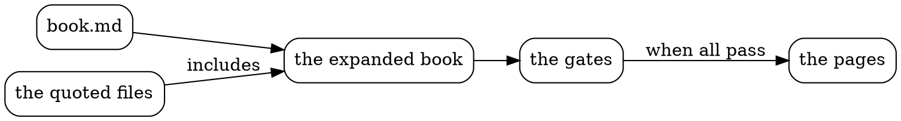
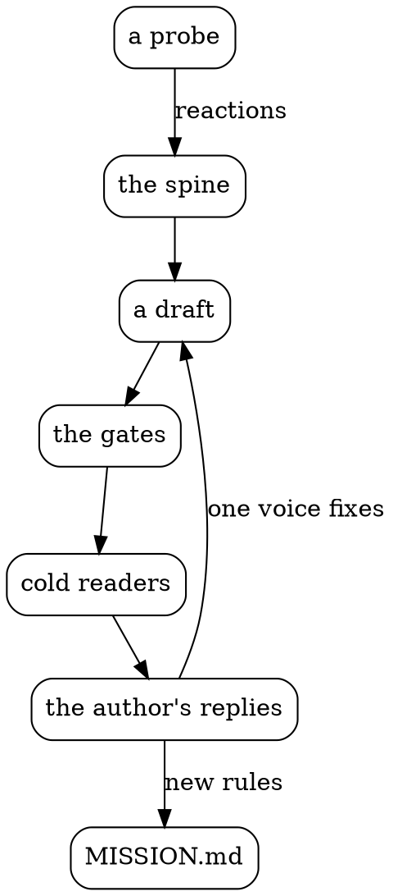

# Building a Book with Claude and Shale

This is a short how-to manual. It shows how the [Safari Ride book](https://roc.lynrummy.com/tutorial/), which teaches Roc through one real program, was built. Claude Code wrote the prose and the code, [Shale](https://github.com/showell/shale) scripts built the pages and checked them, and Steve Howell edited.

It's written for you if you have Claude Code and a GitHub account, can read a little Roc, and are curious enough about the machinery to look under the hood. The book starts Shale from the beginning.

The same machinery builds this book. Its source is one markdown file, `books-book/book.md`, on the [books-book branch](https://github.com/showell/shale/tree/books-book/books-book) of the Shale repository, and every code block in it is quoted from a real file each time the book builds.

The first chapter shows the book as a program. The second teaches enough Shale to run and read its scripts. The third, the heart of the book, is the cadence of drafts and replies that finds a book's voice. The fourth covers working with several agents at once, and publishing.

## The book is a program

A book about code stays true only while its quotes match the code. The Safari Ride book keeps them matched by treating the book as a program: a source file, a build that turns it into pages, and gates that stop the build when something is wrong. This chapter walks through each part, with this book's own builder as the example.

### One source file

The whole book is one markdown file. Its `#` line is the title, the text under that line becomes the contents page, and each `##` heading starts a chapter. Here is a complete book in that shape:

{{file books-book/examples/tiny_book.md}}

The two lines in braces are includes. Each sits alone on its line and names a file. When the book builds, each include becomes a code block holding that file, or a part of it, as it stands that day. Edit the script and the next build quotes the edit, so the prose and the code move together.

This book's builder knows five includes:

| include | what it becomes |
|---|---|
| `{{file PATH}}` | the whole file |
| `{{function PATH NAME}}` | one Shale function, with the comment above it |
| `{{lines PATH from "A" to "B"}}` | the lines from the one holding A through the one holding B |
| `{{runs PATH}}` | a script, and what it printed when the build ran it |
| `{{stops PATH}}` | a script, and the stop it hit |

A line range drifts as a file grows, so `{{lines}}` names two pieces of text instead. Each must appear in the file exactly once, and the builder checks:

{{function books-book/build.shale anchored_line}}

The Safari book's includes go further. Its builder reads Roc with Roc's own parser, so `{{code CatCrossing.cat_instant_at}}` quotes one definition by name, with its doc comment, wherever it sits in its module.

### The build

The build is a Shale script, `books-book/build.shale`. It expands the includes, splits the result at each chapter heading, renders each chapter as a page, and writes the pages to the dev channel, a folder that a web server shows. One command runs it, from the root of the checkout:

```text
shale books-book/build.shale
```



The expansion is one pass over the source's lines. A line that matches an include becomes its block, and any other line holding `{{` stops the build, so a mistyped include stops it in place of reaching a reader:

{{function books-book/build.shale expanded}}

### Gates that stop the build

A gate is a check that stops the build. Each gate here began as a mistake that repeated in an earlier book.

**Every include resolves.** An include that names a missing file, a missing function or an anchor found twice stops the build with a line that says which.

**At most 900 words of prose a page.** Words outside the code count. The limit keeps chapters short, and a chapter over it gets edited down to its key ideas:

{{lines books-book/build.shale from "local words_here = prose_words(c.lines)" to "if words_here > MAX_PROSE_WORDS then"}}

**Say what happens.** The Safari book's strongest voice rule is to describe a thing by what it does. A sentence built on a negative word, such as `not`, `never` or `doesn't`, usually hides a plainer positive one. The cookbook's `prose/find_negatives.shale` finds every such sentence. The build stops on each one until it's rewritten, or listed with its reason in `negatives.txt`. This book's table is empty: every negative was rewritten.

{{function books-book/build.shale negatives_findings}}

**Claims checked against the compiler.** The Safari book teaches Roc's types partly through programs that fail to compile. "This fails" is a claim, so the build checks it. `{{fails turn_as_bearing}}` quotes `fails/turn_as_bearing.roc`, runs the pinned `roc check` on it, and quotes what Roc said. A program with zero errors stops the build, because the book's claim would then be false:

{{function repos:roc-apps/canvas_apps/safari/tutorial/build.shale fenced_failure}}

This book has the same kind of include for Shale. `{{stops PATH}}` runs a script and quotes its stop, and a script that runs to its end stops the build. The next chapter uses it.

### Contents, index and diagrams

The contents page is the text under the title, then each chapter with its sections, all read from the headings. Each chapter page carries the same list in a sidebar, with the current chapter's sections open.

The index comes from the cookbook's `prose/build_term_index.shale`. It reads a terms file, one term a line with the patterns that find it, and writes a table for each category: each term's main chapter and every chapter that mentions it. It also reports smells, such as a term used several chapters before the one that teaches it. Those go to the writer, and stay off the page. This book's terms are in `books-book/index_terms.txt`.

A diagram is a fence tagged `dot`. The build hands its source to Graphviz and puts the drawing in the page, so a diagram changes with the words around it, as the one above does.

## Enough Shale to run the scripts

Every script in the last chapter is Shale. You need enough of it to run the scripts, read them as they scroll by, and judge what the agent wrote. This chapter covers that much.

### What Shale is

Shale is a small scripting language that looks like Lua. It reads, searches and changes a project's files, and runs the project's programs. Its features fit one niche, scripts an agent writes and a person reads:

- Every run has budgets for steps, reads, bytes read and bytes printed. A runaway script stops and names the budget it ran out of.
- `run` starts a program only with a timeout and a keep (`head`, `tail` or `whole`), so a hung test stops, and a long build log comes back as its last lines.
- A script reads and writes only under the folder it runs in and the mounts you name.
- A stop is one line that says where and why.

### Why the agent's shell goes through it

On Steve's machine, every shell command Claude runs is a Shale launch. A Claude Code hook checks each Bash call, and lets through a `shale` launch or an escape whose first line names what Shale lacked. An escape runs, and lands in a log of what Shale should learn next. The hook is a few lines of settings:

{{lines README.md from "Bash|Monitor" to "/ABSOLUTE/PATH/TO/shale/tools/shale-gate.sh"}}

Three things follow. The author reads one language as it scrolls by, in place of bash, Python and sed mixed together. Each script's output stays bounded, which keeps the agent's context clean. And the agent builds up recipes: scripts in the cookbook that do a whole job in one launch, such as the negatives lint.

The ideas in this book carry to any scripting language. Shale makes them cheap to keep, because every script the agent writes is one the author can read.

### Install it

Shale runs on Linux on x86-64, and builds with Zig 0.17.0 beside a checkout of zig-webbox:

{{lines README.md from "git clone https://github.com/showell/shale" to "cd shale && zig build"}}

Put `zig-out/bin` on your PATH. Then make a mounts file, `~/.config/shale/mounts`, with a line that names the cookbook, so any checkout can launch its recipes:

```text
cookbook = /ABSOLUTE/PATH/TO/shale/cookbook
```

This book's builder names three more mounts: `repos`, the folder that holds your checkouts, so an include can quote roc-apps; `build`, whose `roc-apps/next/` folder the dev channel serves; and `scratch`, for temporary files.

### Run a recipe, and read a script

A recipe runs with its values as `name=value` words:

```text
shale cookbook:prose/find_negatives.shale manuscript=book.md table=negatives.txt
```

Most recipes also take `self_test=1`, which runs the recipe on its own test cases. A recipe's header comment says what it does and what it takes, and the [cookbook's README](https://github.com/showell/shale/blob/master/cookbook/README.md) lists every recipe in a line.

A script of your own is a file, or a heredoc on standard input. Here is a short one that counts the prose in each chapter of the tiny book from the last chapter, with what it printed when this book was built:

{{runs books-book/examples/count_words.shale}}

Most of it reads like Lua. `read` reads a file, `lines` splits a string at its line breaks, and `table` lays out a list of records as columns. The differences that catch a newcomer, such as patterns that are regular expressions, are listed in [SHALE-AGENTS.md](https://github.com/showell/shale/blob/master/docs/SHALE-AGENTS.md), under "If you write Lua".

### Read a stop

When a script goes wrong, Shale stops it with a line that says where and why. This script asks git for its newest commits and leaves out the timeout that `run` requires:

{{stops books-book/examples/run_without_timeout.shale}}

The first line names the problem and the rule behind it. The `called from` line points at the script's own line 2, and the last line says what the run used. The agent reads a stop like this and fixes its script, and the author usually reads only the agent's one-sentence account of it. The build reruns the script every time, so the quote above is what Shale says today.

### Build this book

To build this book yourself, clone the Shale repository, check out the `books-book` branch, set up the mounts, and run the build from the checkout's root. It prints each page's words of prose and the lint's verdict, fetches every page from the dev channel, and ends with the number of pages that answered.

## Finding the voice with the agent

The machinery keeps a book true. A book's voice comes from a cadence of drafts, replies and rules between the author and the agent. In the Safari book, the agent wrote every sentence and Steve edited. This chapter is how that worked, step by step.



### A probe first

Start with a probe: a draft written to be thrown away. Ask the agent for a whole rough book in an hour or so, long enough to generate ideas and short enough for the author to read in one sitting. The author reacts, and the reactions find the book's real frame. The Safari book's lessons put it this way:

{{lines repos:roc-apps/canvas_apps/safari/tutorial/MISSION.md from "**Define the whole book's spine before drafting chapters.**" to "**Every book starts with a probe.**"}}

### Settle the spine

After the probe, agree on the spine before drafting the book you keep. A spine is a chapter written as one sentence per paragraph, each following from the one before by "so" or "but". It's cheap to fix, and a weak one costs a rewrite later. The Safari book's loop writes one for every chapter:

{{lines repos:roc-apps/canvas_apps/safari/tutorial/MISSION.md from "3. **The spine.**" to "3. **The spine.**"}}

### Prompt, essay, reply

Long-form work goes through an essay surface: a small web app that shows the agent's writing as pages, with a reply button on every paragraph. Steve's is [essay-surface](https://github.com/showell/essay-surface), a Go server with a JavaScript front end. The cadence has three steps:

1. The author gives a short prompt in the console: a chapter to draft, a question to think through, a decision to lay out.
2. The agent writes the draft or an essay as a note on the surface, and hands over its link.
3. The author reads it in the browser and replies on the paragraph each reply is about. The replies land in a file beside the note, where the agent reads them.

The agent writes every draft, and the author's words arrive as replies. A reply is precise: "this paragraph uses *sighting* before it says what one is" lands on that paragraph, and the agent fixes that paragraph. A decision goes in an essay too, with its options laid out, so the author's reply is a choice.

A pull request with review comments works the same way. The surface is faster: a note is a file the agent writes, and a reply is a line the agent reads.

### A MISSION file

A reply that generalizes becomes a rule, and the rules live in one file, `MISSION.md`, beside the book. Every writer and reader of the book, human or agent, reads it first, and the agent reads it again after each compaction of its context. A rule says why, and quotes the author with the date of the reply, so a later reader can weigh it:

{{lines repos:roc-apps/canvas_apps/safari/tutorial/MISSION.md from "**A7.**" to "**A7.**"}}

The Safari MISSION groups its rules by axis: purpose, truth, order, voice, tone, vocabulary, the code, pictures and completeness. Each axis fails in its own way and takes its own kind of read.

### Cold readers with narrow briefs

A cold reader is a fresh agent that sees only the built chapter and its brief. Give each one a narrow job, because a reader asked to find everything finds the obvious. The Safari book used these:

| reader | its one job |
|---|---|
| truth and order | each sentence against the code, and each paragraph against only the pages before it |
| promise check | every promise the text makes, and where the book pays it |
| think-aloud | its understanding, paragraph by paragraph, so a break in the flow shows |
| voice | each sentence against the voice rules, naming the rule it breaks |
| nitpick | the five things a careful reader would stumble on, from a bare brief |

A nitpick round runs with a fresh agent each time, and the rounds stop when one finds only trivia, or after three.

### One voice

The readers report, and one voice phrases every fix:

{{lines repos:roc-apps/canvas_apps/safari/tutorial/MISSION.md from "**One voice.**" to "**One voice.**"}}

In practice the agent that wrote the chapter takes the findings, keeps the ones that fix something real, and rewrites in its own words. It fixes by subtraction first: cut the sentence, or move it, before adding one.

### A gate the moment a mistake repeats

A correction made once is a reply. When the same mistake comes back, write the check that catches it, in the same session, and add it to the build. A rule in MISSION depends on someone reading it, and a gate runs on every build. Three of the Safari book's gates began this way:

- Steve kept striking negative sentences, so `find_negatives.shale` became a gate.
- Chapters kept growing, so the 900-word limit moved from a rule into the build.
- Diagrams kept arriving too dense to read, so the essay surface's `scripts/check_note.shale` stops a note whose diagram is wider than the page's column or holds more than ten nodes.

## Orchestration and publishing

Everything so far works in a single Claude Code session. This chapter covers the step past it, Claude orchestrating other agents, and then how a finished book reaches its readers.

### One session

In one session, the agent drafts a chapter, runs the build, posts the chapter as a note, and reads the author's replies. For a cold read, open a second session with the brief and the built page, and paste its report back. Start this way. The cadence makes the book, and more agents only make it faster.

### An orchestrator and its subagents

As the book grows, Claude can work as an orchestrator. It keeps the plan, writes the briefs, starts subagents with Claude Code's Agent tool, checks what they return, and keeps the author on one task at a time.

- **A lane** is a separate checkout on its own branch, where one agent works on one thing: a chapter's rewrite, a fix to a recipe, a new gate. A git worktree or a fresh clone both serve. This book's lane is a clone of the Shale repository on the `books-book` branch.
- **Cold readers run in parallel.** They only read, so several can run at once. Then one editor applies a triaged list of their findings, in one voice.
- **The brief carries everything.** A subagent knows only its brief, so name the files to read, the one thing to check and the shape of the report. Leave your own conclusion out of it, so the read stays independent.
- **The long jobs are the orchestrator's.** It runs the slow builds in the background, and keeps the subagents on quick checks.

### Publishing

The Safari book moves through three channels.

1. **Dev.** Every build writes to a stage of the dev channel, a folder a web server shows. A draft gets its own stage, so it leaves the main copy alone. This book's stage is `books-book`.
2. **Staging.** The Safari book's `book.shale` builds into a trial folder first. Then `book_check.mjs` drives each page in headless Chromium, and stops on a console error, a failed request, a widget that fails to run, a diagram that fails to draw, a broken link, or a page that runs past the window at desktop, tablet or print width. A book that passes replaces the channel's copy. Then `site/publish.sh tutorial` copies it into the roc-apps repository's `site/live/` folder and commits it, with a record of the compiler and the commit that built it.
3. **The public site.** A deploy copies staging to [the public site](https://roc.lynrummy.com/tutorial/).

Before each publish, the author reads every page once, as a reader would. The gates check what can be written down; the author checks what's left, the accuracy, the voice and the framing.

### Your own book

1. Pick a real program small enough to quote whole, and a reader.
2. Ask the agent for a probe, read it in one sitting, and react.
3. Agree on the spine.
4. Start `MISSION.md` with the rules your reactions produced.
5. Copy a builder. This book's `books-book/build.shale` needs only Shale and Graphviz.
6. Draft a chapter at a time: the build, the cold readers, one voice, your replies.
7. Add a gate each time a mistake repeats.
8. Publish when the gates pass and you've read every page.

The Safari Ride book's [tutorial folder](https://github.com/showell/roc-apps/tree/master/canvas_apps/safari/tutorial) holds everything this book describes: its MISSION, its source, its builders and its browser check. Read its MISSION's last section, "Lessons for the next book", before you start yours.
